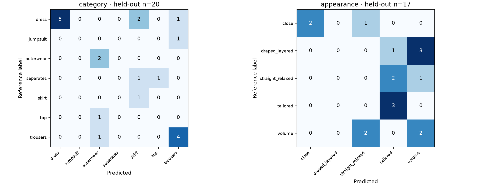
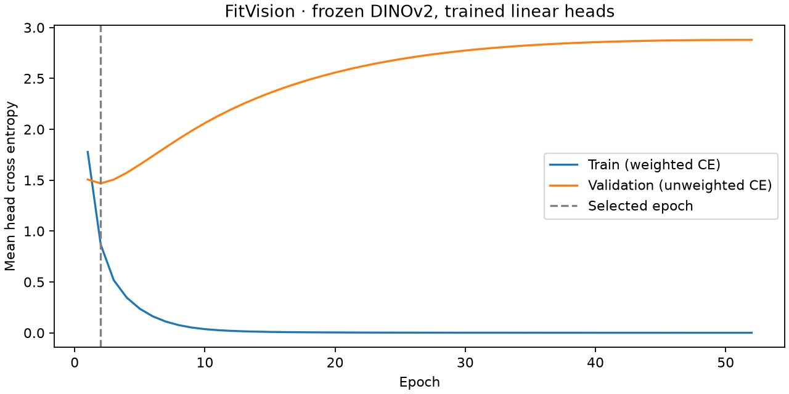

# Kết quả huấn luyện FitVision AI v0.1

Huấn luyện và kiểm tra ngày **27/10/2026** trên máy của dự án. Đã tạo trọng số phân loại bằng cập nhật gradient thật, nạp lại để suy luận và chạy lại cùng cấu hình. Trạng thái sử dụng: **nghiên cứu thử nghiệm**. Kết quả hiện chưa đủ để tự chỉnh phom hoặc thay thế mô phỏng vải.

## Mô hình đã học phần nào

Encoder là [DINOv2-small](https://huggingface.co/facebook/dinov2-small), revision `ed25f3a31f01632728cabb09d1542f84ab7b0056`. Theo model card, đặc trưng CLS của encoder có thể dùng để huấn luyện bộ phân loại phía trên. Dự án giữ nguyên encoder và huấn luyện **hai lớp linear**, tổng **4.620 tham số**. Không huấn luyện lại hàng triệu tham số của encoder, cũng không cập nhật trọng số của trợ lý trò chuyện.

| Đầu ra | Nhãn được học |
| --- | --- |
| Loại trang phục chính | Đầm, chân váy, quần, áo, áo khoác/choàng, jumpsuit, bộ phối |
| Nhóm phom quan sát | Ôm/dáng cột; xòe/thể tích lớn/xếp ly; suông/rộng; quấn/xếp rủ/nhiều lớp; có cấu trúc may |

Các nhóm phom là cách gộp nhãn thủ công có sẵn, không phải phép đo độ ôm. Một trang phục có thể vừa ôm vừa nhiều lớp; bộ nhãn loại trừ nhau hiện tại chưa diễn tả hết trường hợp đó. Ba ảnh `MW024`, `MW036`, `MW069` có nhãn gốc `mixed` hoặc `slit`, không đủ để gán chắc một nhóm phom, nên bị bỏ qua khi tính loss/metric đầu phom; vẫn giữ nhãn loại trang phục.

## Dữ liệu và cách tránh kết quả tăng giả

Nguồn là **100 ảnh** trong `References/ModelWear100`, có nguồn/ghi công/giấy phép trong manifest. Kiểm tra SHA256 mọi ảnh trước khi chạy. Ảnh giữ nguyên; khi đưa vào encoder, sửa hướng EXIF, chuyển RGB rồi letterbox 224×224 để giữ toàn bộ khung hình, không cắt giữa làm mất gấu. Pixel được chuẩn hóa theo processor của encoder.

Tách **60 ảnh train, 20 validation, 20 test** theo **87 nhóm trang phục**. Các góc của cùng bộ đồ đã biết được giữ cùng nhóm. Dò thêm cặp embedding cosine ≥0,985 không tìm thêm cặp nào. Nhóm không giao nhau giữa ba phần. Việc nhóm dựa trên quan sát bộ đồ, không phải một phép tách danh tính người đã được xác minh; ảnh khác bộ nhưng cùng sự kiện/phông nền có thể vẫn ở nhiều phần. Không biết ảnh nào từng nằm trong pretraining của DINOv2.

Chuẩn hóa đặc trưng chỉ dùng train; trọng số loss dựa vào số nhãn train. Chọn cách chia bằng số lượng nhãn để mọi lớp có mặt, không dùng hiệu năng ảnh kiểm tra. Lớp hiếm vẫn rất ít: jumpsuit chỉ có một ảnh train, áo hai ảnh train. Xem số lượng đầy đủ theo lớp trong `Artifacts/metrics.json`.

Huấn luyện bằng AdamW, learning rate 0,01, weight decay 0,1; loss CE có trọng số nghịch căn số lượng lớp trên train. Tối đa 400 epoch, dừng khi validation CE không cải thiện trong 50 epoch. Thực tế chạy **52 epoch**, giữ checkpoint tốt nhất ở **epoch 2** theo validation CE trung bình hai đầu. Nhiệt độ softmax được chọn riêng từng đầu từ validation, không từ test; validation chỉ có 20 ảnh nên xác suất vẫn cần kiểm tra và chưa được xác nhận hiệu chuẩn ngoài bộ dữ liệu.

## Kết quả trên tập test

| Bài nhận diện | Số ảnh tính điểm | Đúng | Accuracy | Balanced accuracy | Macro F1 | Baseline đoán lớp phổ biến nhất của train |
| --- | ---: | ---: | ---: | ---: | ---: | ---: |
| Loại trang phục | 20 | 12 | **60,0%** | 48,9% | 0,366 | 40,0% accuracy |
| Nhóm phom | 17 | 7 | **41,2%** | 43,3% | 0,373 | 17,6% accuracy |

Ba ảnh thiếu nhãn phom đều thuộc test trong cách chia cố định này, nên đầu phom có 17 ảnh tính điểm. Không lấy accuracy trên train (80,0% loại đồ, 86,7% phom) làm kết quả tổng quát hóa.

Bootstrap theo nhóm trang phục, 2.000 lần lấy mẫu, cho khoảng accuracy 95% xấp xỉ **36,8–81,8%** ở loại trang phục và **15,8–66,7%** ở nhóm phom. Tập test nhỏ làm khoảng rất rộng; các con số không chứng minh độ tin cậy với ảnh mới ngoài nguồn chụp hiện có.

Nhóm quấn/xếp rủ/nhiều lớp bị sai cả bốn ảnh test; suông/rộng sai cả ba ảnh test. Áo và jumpsuit có quá ít ví dụ để đánh giá riêng đáng tin. Các ảnh nhiều món dễ bị nhầm nhãn chính: với `MW002` (nhãn quần), mô hình dự đoán áo trong phép thử suy luận; ảnh thực sự có cả áo lẫn quần. Đây là hạn chế của nhãn chính toàn ảnh và thiếu vùng chọn món đồ.

Validation xấu đi khi tiếp tục học trong khi train loss giảm. Vì vậy chạy thêm epoch trên bộ này không giải quyết được độ chính xác thấp; checkpoint sớm được giữ lại thay cho checkpoint cuối đã ghi nhớ train.

## Trọng số, môi trường và kiểm tra

- Trọng số mới: `Artifacts/heads.safetensors`; cấu hình đi kèm: `Artifacts/model.json`.
- SHA256 checkpoint: `195f9f5b7e5ebaf8f30451037b44e6ef2a97262c0d81a18e4415e6b41fa630c1`.
- Seed: `27102026`; PyTorch `2.14.1+cpu`, Python `3.12.10`; máy Ryzen AI 7 350, chạy CPU với 4 luồng. Không dùng GPU Radeon cho bài này.
- Lần đầu gồm tải encoder/trích đặc trưng/huấn luyện mất khoảng 61 giây bên trong hàm train; lần chạy lại dùng feature cache mất khoảng 14,7 giây. Không bao gồm cài môi trường hoặc thời gian khởi động Python.
- Chạy lại cho cùng checkpoint hash. Log sạch có kết thúc thành công ở `Artifacts/retrain_verified.log`.
- `verify_fitvision.py` kiểm tra hash 100 ảnh, nhóm không giao nhau, tham số hữu hạn và đã cập nhật, tính lại accuracy từ CSV, so sánh suy luận độc lập trên ba ảnh test đầu tiên với kết quả đã lưu, và từ chối checkpoint sai hash. Kết quả máy kiểm tra trong `Artifacts/verification.json`.
- Công cụ Unity Editor mới được biên dịch bằng compiler và thư viện của Unity 2022.3.62f1, không lỗi/cảnh báo. Log: `Verification/FitVision-Compile.log`. Chưa thao tác thử toàn bộ cửa sổ trong Unity hoặc kiểm thử trên headset.

## Áp dụng trong dự án và giới hạn

Menu **Fashion Fit > AI > Analyze Garment Photo** cho chọn ảnh và xem dự đoán từ mô hình đã lưu. Python chạy nền khi bấm phân tích, không chạy trong vòng lặp frame. Phần gợi ý dựng phom là quy tắc lập trình theo nhãn AI; không phải hình học/độ dư/vật liệu được AI suy ra. Công cụ không tự sửa mesh, collider hay tham số solver.

**Chưa học**: pattern may, số đo cơ thể, mesh mặc đúng, trọng lượng/độ co giãn vải, chuỗi bước đi, quán tính hoặc điều kiện không xuyên. Bộ ảnh không chứa nhãn cho những đại lượng đó. Nhận diện phom từ ảnh cũng không chứng minh quần áo mô phỏng đã đẹp hoặc không xuyên cơ thể.

Cải thiện tiếp cần nhãn vùng trang phục và các thuộc tính riêng (độ ôm, độ xòe, lớp, xẻ), nhiều mẫu cân bằng hơn và test từ sự kiện/nguồn chụp mới. Học 3D/chuyển động cần dữ liệu body–garment/pattern và chuỗi motion đồng bộ; không chỉ tăng số epoch hay số điểm mesh.

Đường dẫn sử dụng, huấn luyện lại và nguồn: [README.md](README.md), [THIRD_PARTY_NOTICES.md](THIRD_PARTY_NOTICES.md).
