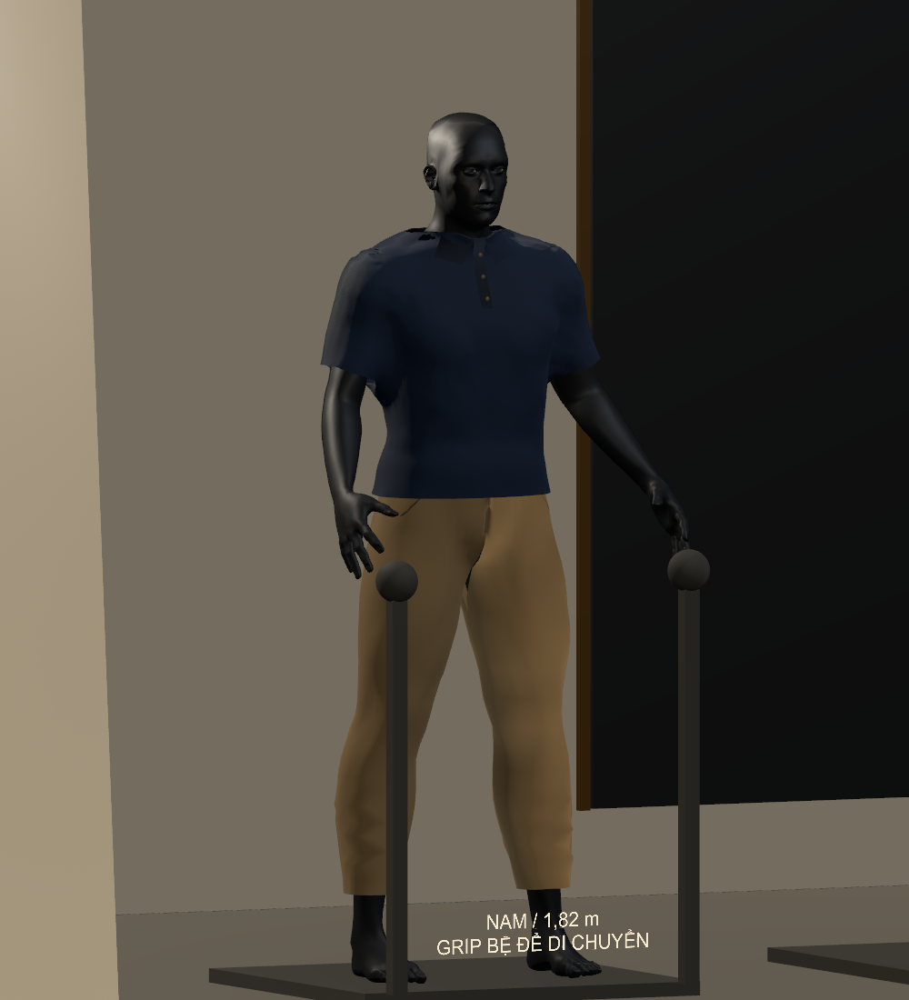
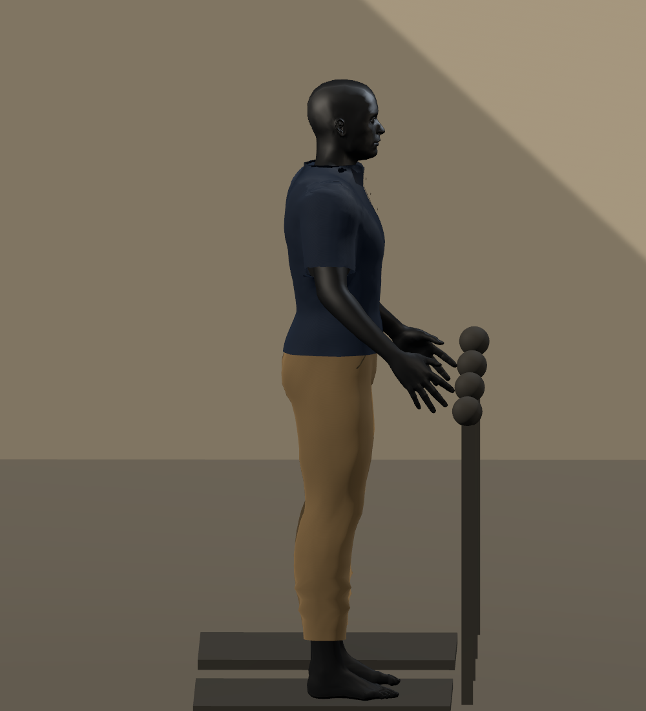
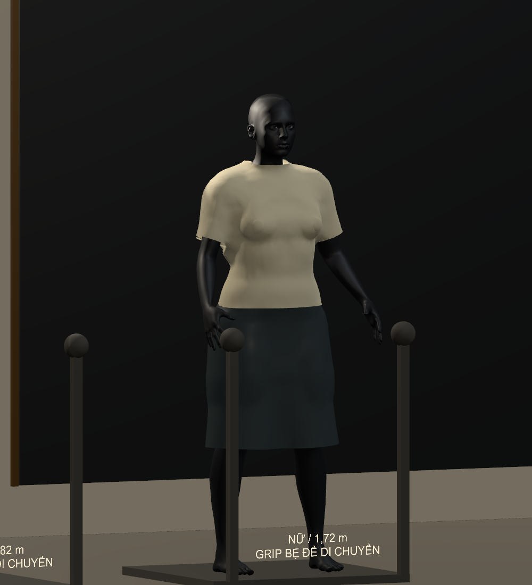

# V092 — sửa phom mặc ban đầu

## Nguyên nhân và thay đổi

- Đo trên lưới gốc cho thấy áo đã phồng trước khi mô phỏng. Khoảng hở cộng thêm ở thân, lớp bao elip và tay áo khiến nhiều vùng cách cơ thể 4–10 cm.
- Thêm GarmentCloseFit để căn thân áo theo mặt cắt lồi của cơ thể, thu tay áo theo bề mặt và chuyển tiếp liên tục ở vai. Làm mượt phần trong lưới, giữ mép cổ, gấu và cửa tay rồi kiểm tra khoảng hở tiếp xúc.
- Giảm phần rộng cộng thêm của cả năm bộ nam. Ống quần lấy kích thước từng mặt cắt chân và hông, gấu cao hơn để giảm phần vải dồn ở bàn chân.
- Sửa cổ/nẹp polo lấy nhầm mặt sau của áo khi tia chiếu đi qua lỗ cổ. Chi tiết phía trước dùng cả bề mặt áo và bề mặt cơ thể. Cổ gập và miệng túi được chia nhỏ để tránh các tấm tam giác dài.
- Cập nhật cả Polo Study mặc mặc định trên mannequin nam, áo Ivory của mannequin nữ và cache áo chính. GUID của các asset đã có được giữ nguyên.
- Thêm hai bước kiểm tra phom vào bộ full. Bài đo độc lập chặn thân áo có p95 khoảng hở từ 50 mm trở lên và mẫu xuyên trên 1 mm. Bài Editor chặn chi tiết cổ dịch quá 40 mm ngay ở tư thế trung tính.
- Sửa nhãn telemetry ghi cố định V090 thành phiên bản thật của ứng dụng. Bộ cuối ghi 0.9.2 và log Ready V092_CLOSE_FIT. Các cache thử V4/V5/V6 đã được loại khỏi project thử trước khi build.

## Kết quả đo phom

Khoảng cách từ các đỉnh áo vùng thân đến tam giác cơ thể được đo bằng libigl ở cùng tư thế trung tính. p95 nghĩa là 95% đỉnh trong vùng đo có khoảng cách không vượt giá trị đó. Đơn vị mm.

| Áo | Trước p95 | Sau p95 |
|---|---|---|
| FemaleIvory | 68.0 | 32.9 |
| MalePolo | 89.2 | 33.8 |
| MaleRugby | 107.4 | 40.4 |
| MaleHenley | 81.3 | 35.8 |

Cả bảy trường hợp có 299,553 mẫu kiểm tra gồm đỉnh, tâm tam giác và trung điểm cạnh. Không thấy mẫu xuyên cơ thể quá 1 mm trong các trường hợp này.

[Số đo trước](evidence/before_fit_metrics.json) · [Số đo sau](evidence/fit_metrics.json).

## Kiểm tra trên bản cuối

- Bộ full đạt 18 bước, gồm 68 kiểm tra của 34 khớp, 91 kiểm tra tương tác hai tay, 7 trường hợp phom và build Windows.
- EXE cuối đạt nhóm surface, pose/nón, năm bộ nam và áo dài. Kiểm tra tiếp xúc độc lập đạt 8 trạng thái surface, 20 trạng thái đồ nam và 5 trạng thái áo dài ở ngưỡng 1 mm.
- Ảnh chính diện và nghiêng của cả bảy trường hợp đã được xem trong vòng sửa. Các thay đổi được cài vào source chính và EXE V092 nằm cạnh V091.

[Bộ full](evidence/full_suite.json) · [Khớp pose](evidence/pose_joints.json) · [Hai tay](evidence/bimanual.json) · [Đồ nam](evidence/mens_contact.json) · [Áo dài](evidence/layers_contact.json).

## Ảnh sau sửa

## Giới hạn còn lại

- Độ phồng lớn đã giảm nhưng vùng nách, vai và ngực vẫn có nếp gãy và độ trơn nhân tạo. Chất lượng hình ảnh còn cần làm tiếp.
- Lượt này sửa phom mặc ban đầu. Chế độ mặc/cởi vật lý tự do của V091 vẫn INCOMPLETE, còn lỗi giãn quá mức và xuyên khi thao tác khó. Thông số vật liệu chưa được hiệu chuẩn bằng phép đo vải thật.
- Lượt desktop có p95 wall frame 29.8 ms. Đó là app timing gồm chờ/pacing. Chưa đạt bằng chứng 72 Hz ổn định và chưa kiểm chứng bằng kính/Touch thật.
- Lấy mẫu tiếp xúc ở các tư thế kiểm tra chưa chứng minh chống xuyên liên tục cho mọi chuyển động hoặc tự va chạm vải.

[Hiệu năng](evidence/performance.json) · [Kiểm tra bản ghi](evidence/capture_analysis.json).

## Mở bản mới

Thoát game cũ rồi mở Desktop → FashionFit VR → 01 - VAO GAME VR. Trong màn hình Unity chọn VR/CAMERA → Chuẩn bị phiên VR → Vào VR sau khi đã vào Quest Link.

EXE ở C:\Users\HUYNH\Downloads\FashionFit_Run\Versions\V092_CloseFit\FashionFittingRoom.exe. Source ở C:\Users\HUYNH\OneDrive\Desktop\FashionFitPrototype.

Bằng chứng đầy đủ và lưới nhị phân của lượt thử được giữ tại C:\Users\HUYNH\Downloads\Fashion_Fitting_Room_v0.5.2\_Luu_tru\Phat_trien_2026-11-03\CloseFit\FullSuite\20261103T053640478136Z.
