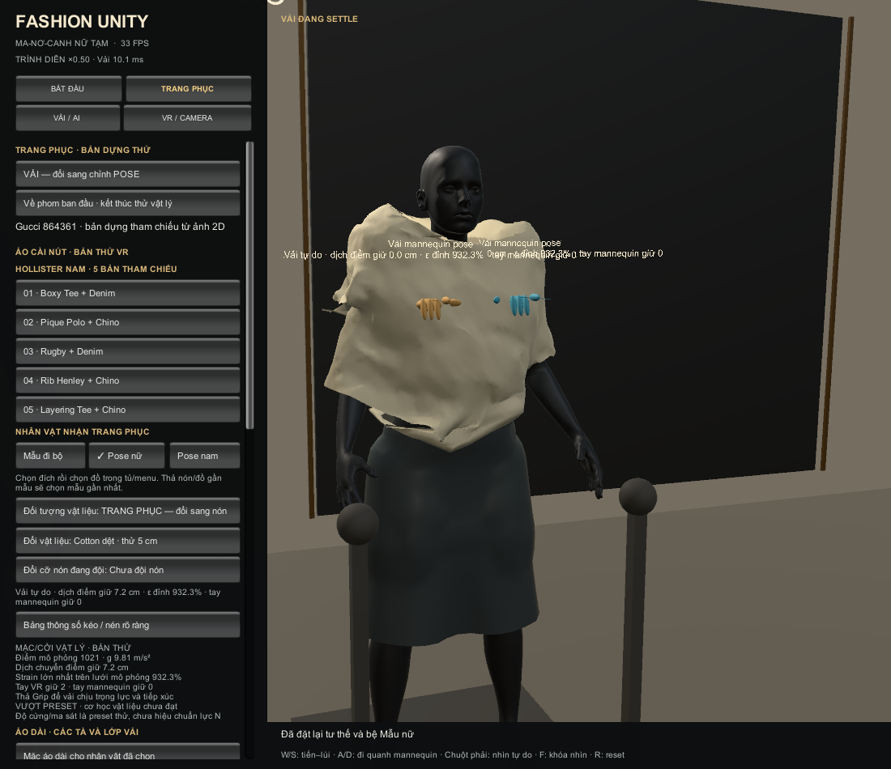
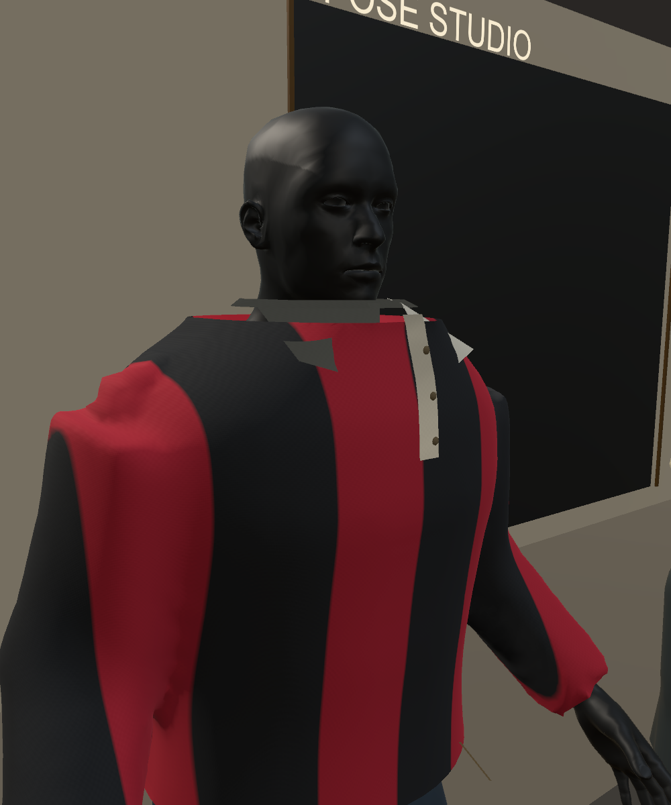

# V091 — kết quả Grip khớp và thử mặc/cởi

**Bản dùng thường đã qua kiểm tra tự động. Chế độ mặc/cởi vật lý còn INCOMPLETE và được bật riêng.**

## Code và nội dung

- Đưa marker khớp ra phía trước cơ thể, ưu tiên chọn khớp khi ở chế độ POSE và làm rõ nút đổi chế độ trên bảng VR.
- Đổi ba áo nam tay dài Rugby, Henley và Layering sang thân–tay liên tục. Phom rộng, cổ và chi tiết may còn thô, cần làm tiếp.
- Thêm lưới mô phỏng theo từng mảnh trang phục, hai điểm Grip độc lập, trọng lực, ma sát, điểm giữ của tay mannequin và nút về phom do người dùng bấm.
- Khi thả Grip, bỏ liên kết xương điều khiển của điểm vải. Khoảng cách nghỉ được giữ để mô tả biến dạng đàn hồi, vị trí tiếp tục phụ thuộc chuyển động và tiếp xúc.
- Bản vật lý dùng preset thử, có cảnh báo vượt strain. Các thông số lực N và sức bền thực chưa được hiệu chuẩn.

## Bằng chứng kiểm tra

| Phạm vi | Kết quả |
|---|---|
| Bộ full trước vòng chỉnh proxy cuối | 16 bước đạt, gồm 68 kiểm tra của 34 khớp |
| EXE cuối | 9 bước Windows player đạt, gồm surface, pose/nón, 5 bộ nam, áo dài và kiểm tra tiếp xúc độc lập |
| Tiếp xúc thông thường | 33 trạng thái được lấy mẫu, gồm 20 trạng thái của 5 bộ nam, đạt ngưỡng 1 mm |
| Bản vật lý tự do | 12 kiểm tra chức năng đạt, kiểm tra cơ học và tiếp xúc tổng thể chưa đạt |

Bộ full và EXE cuối có báo cáo tách biệt. Những thay đổi sau bộ full nằm trong nhánh vật lý thử được bật riêng. Đầu vào Touch được tiêm bằng bài kiểm tra, chưa xác nhận trải nghiệm bằng kính thật.

[Bộ full](evidence/normal_suite.json) · [EXE cuối](evidence/final_player_suite.json) · [34 khớp](evidence/pose_joints.json) · [20 trạng thái đồ nam](evidence/mens_contact.json).

## Lỗi còn lại trong bản vật lý tự do

| Trạng thái lấy mẫu | Số điểm sâu hơn 1 mm | Độ sâu lớn nhất mm |
|---|---|---|
| foreign_hand_body.bin | 531 | 49.41 |
| initial.bin | 0 | 0.00 |
| mannequin_hold.bin | 0 | 0.00 |
| pulled.bin | 0 | 0.00 |
| released.bin | 73 | 88.81 |
| two_hands.bin | 0 | 0.00 |

Strain cạnh lớn nhất quan sát được khoảng **968.6%**, vượt preset cotton 22%. Đây là lỗi cơ học của bản thử. Mật độ lưới và kết quả nhận Grip chưa đủ để kết luận vật liệu đúng.

Bài giữ chéo có bước đặt fixture mannequin tới gần áo. Va chạm với cơ thể thứ hai và sau khi thả vẫn thất bại. Chưa chứng nhận va chạm liên tục, tự va chạm hoàn chỉnh hoặc mọi tư thế.

[Kết quả cơ học](evidence/physics_quality.json) · [12 kiểm tra chức năng](evidence/physics_trial.json) · [Kiểm tra tiếp xúc](evidence/physics_contact.json).

## Hiệu năng và cấu hình

- Bài desktop dùng thường trên EXE cuối có 645 frame render, p95 wall frame khoảng 46.7 ms.
- Bài vật lý tự do có 321 frame render, p95 wall frame khoảng 81.1 ms.
- Hai bài có thao tác khác nhau và warmup 1 giây. Các số trên gồm pacing/chờ và các đợt giật trong bài thử. Mục tiêu 72 Hz tương ứng 13,89 ms chưa đạt.
- Không có frame XR active trong các lượt đo. Hiệu năng Quest Link, Touch thật, ASW/compositor và độ trễ toàn chuỗi còn NOT_ASSESSED.
- Build bật Frame Timing Stats và dùng cấu hình nhẹ đã kiểm tra với AA 2x, shadow resolution thấp. Các thay đổi cấu hình được lưu trong bản cập nhật.

[Đo desktop](evidence/normal_performance.json) · [Đo bản vật lý](evidence/physics_performance.json).

## Phần cần phát triển tiếp

1. Thay tiếp xúc proxy bằng bề mặt cơ thể/SDF biến dạng và kiểm tra quét cho hạt, cạnh, tam giác, đặc biệt ở đầu và tay của mannequin khác.
2. Đặt giới hạn strain vật liệu trong solver và giới hạn lực/độ dịch chuyển tại điểm Grip để tránh neo động học kéo vải vượt khả năng vật liệu.
3. Tạo seam graph cho thân áo, tay, cổ, cửa tay và các chi tiết may. Cần rập và mesh trang phục có cấu trúc đúng để cải thiện fit.
4. Hiệu chỉnh bằng dữ liệu kéo dọc/ngang, uốn, nén và ma sát đo được, rồi thử lại với Quest Link thật.

Unity Cloth đang dùng chỉ nhận các collider capsule/sphere được chỉ định. Cần xét giới hạn này khi phát triển tiếp xúc chính xác hơn. [Unity Cloth 2022.3](https://docs.unity3d.com/2022.3/Documentation/Manual/class-Cloth.html).

Lưới điều khiển dùng phần MeshSimplifier của UnityMeshSimplifier, commit 53fdb3122645bcd3ad2c258235200dff3dfbaa9b, MIT. License và notices đi kèm code. [Mã nguồn](https://github.com/Whinarn/UnityMeshSimplifier/tree/53fdb3122645bcd3ad2c258235200dff3dfbaa9b).

[Cách mở và thử V091](../../Docs/CONTACT_DRESSING_GUIDE.md).
