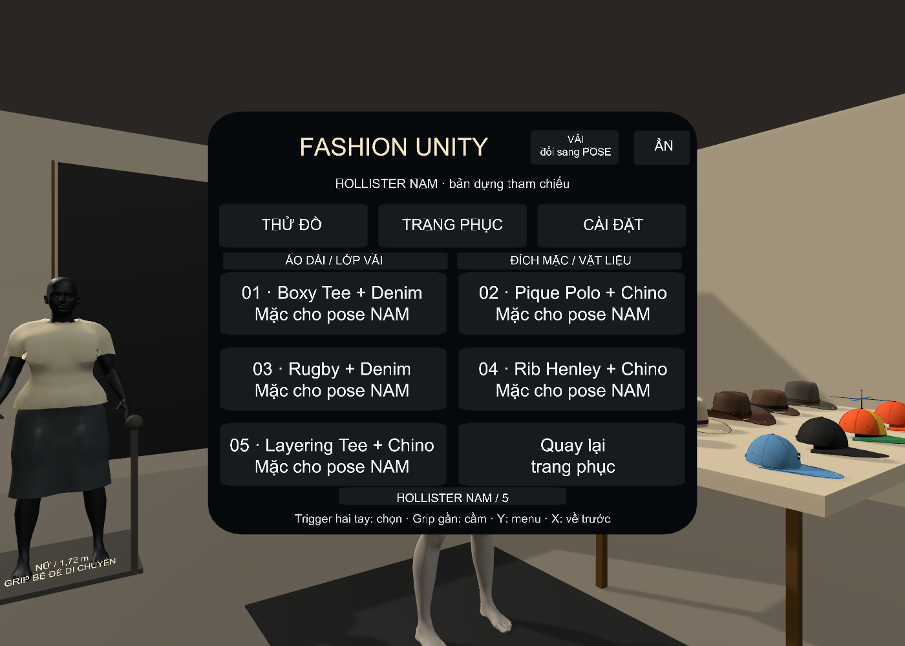
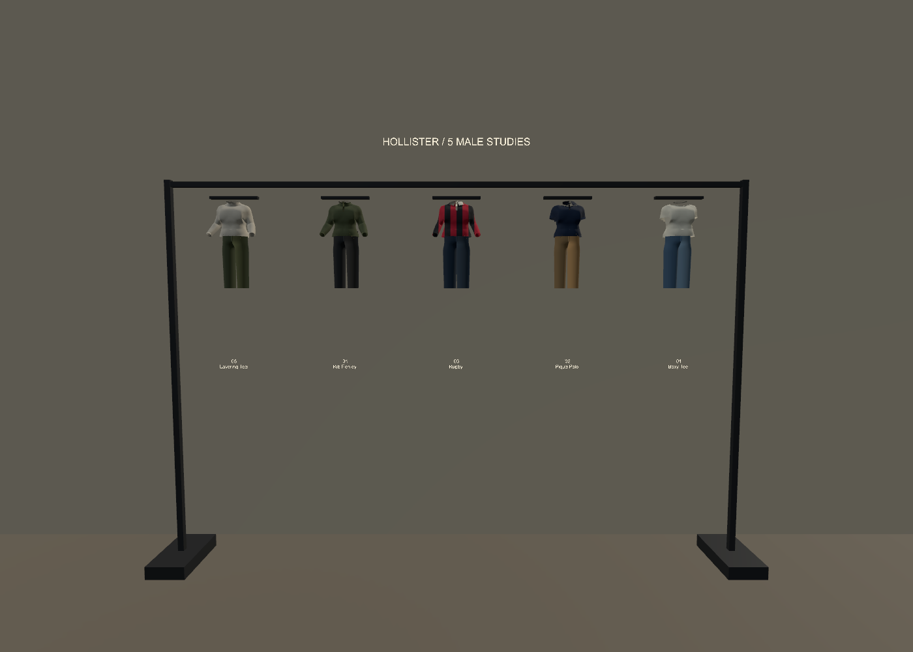
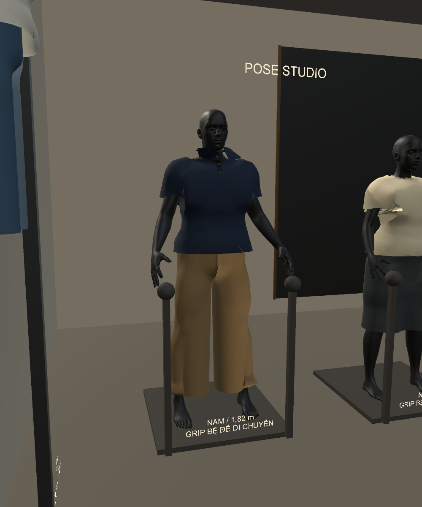
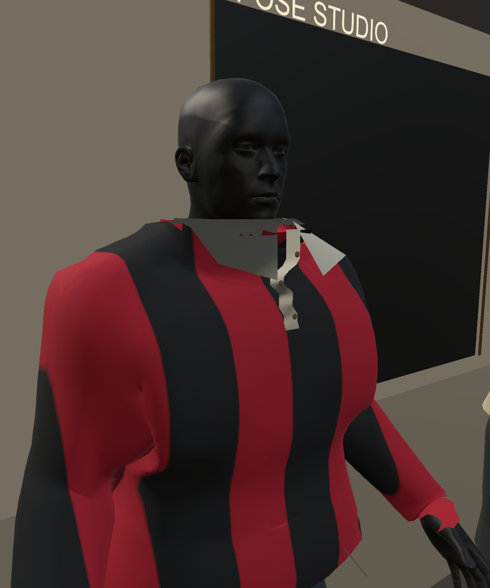

# 5 bộ nam tham chiếu Hollister — V087

Ngày 01/11/2026. Source sửa trực tiếp: `C:\Users\HUYNH\OneDrive\Desktop\FashionFitPrototype`.
EXE mới: `C:\Users\HUYNH\Downloads\FashionFit_Run\Versions\V087_Mens\FashionFittingRoom.exe`.
[Hướng dẫn VR](../../Docs/HOLLISTER_MENS_VR_GUIDE.md) · [Xem dữ liệu và ảnh](../../AI/HollisterMens/Reference/BROWSE.html).
`deployment.json` và `actual_player.json` xác nhận việc cài/chạy tại đường dẫn thật sau khi phát hành; các kết quả bên dưới là build kiểm thử.

## Đã đưa vào

5 asset mesh độc lập, mỗi bộ có 4 nhóm vật liệu: thân/tay áo, quần, cổ/nẹp và nút/đường nhấn. Có normal weave/rib và texture sọc tự tạo bằng code. Quần dùng lưới hai ống và phần rise nối vào hông, không sao chép bề mặt giải phẫu vùng đáy. Các đỉnh trùng ở nẹp đã được nối để các hàng không nhận hiệu chỉnh va chạm độc lập rồi tách khe.

| Bộ | Áo và chi tiết chính | Quần phối |
|---|---|---|
| 01 | Boxy Crew Tee: cổ tròn bo, tay ngắn, thân có độ dư | Denim nhạt |
| 02 | Pique Polo: cổ gập, nẹp và 3 nút hình học, navy | Chino khaki |
| 03 | Rugby: tay dài, sọc dọc đỏ/than, cổ sáng | Denim đậm |
| 04 | Rib Henley: cổ tròn/nẹp, tay dài, olive | Chino than |
| 05 | Layering Tee: cổ tròn, tay dài, ivory | Chino olive |

Nút **HOLLISTER NAM / 5** trong menu Y, mục riêng trên desktop, và thanh treo bên phải có 5 mẫu Grip/thả gần mẫu nam để mặc. Chỉ mặc cho mannequin pose nam; không đổi đồ của mẫu nữ/mẫu đi bộ. Vẫn giữ hai tay, chỉnh khớp, điểm tựa, giới hạn kéo và hồi của V086. Bản mới đặt cạnh bản cũ để không cần thay các tệp đang bị tiến trình game cũ khóa. Launcher Desktop mở bản mới sau khi người dùng thoát cửa sổ game đang chạy.

## Dữ liệu đã thu thập

**7 hồ sơ sản phẩm, 11 ảnh gốc**, có URL và SHA256, ở `AI/HollisterMens/Reference`. Đây là dữ liệu tham chiếu sản phẩm, không phải 5 bộ mesh/rập của hãng và chưa phải tập train được cấp quyền. Chỉ lưu các thuộc tính kiểm chứng được; không chép mô tả quảng cáo dài.

| Sản phẩm nguồn chính hãng | Thuộc tính đã xác nhận |
|---|---|
| [Boxy Heavyweight Crew Tee](https://www.hollisterco.com/shop/us/p/heavyweight-boxy-camo-pattern-t-shirt-60556819) | Cotton 100%; 235 gsm; boxy, cổ tròn, tay ngắn. Size M công bố dài 27,5 inch = 0,6985 m. URL giữ tên lịch sử có “camo”, nhưng trang có các biến thể trơn; ảnh tải là biến thể đen. |
| [Must-Have Icon Polo](https://www.hollisterco.com/shop/us/p/classic-fit-icon-polo-63915839) | Cotton 98%, elastane 2%; pique, classic fit, cổ/nẹp, tay ngắn. |
| [Rugby Polo](https://www.hollisterco.com/shop/us/p/boxy-long-sleeve-logo-graphic-rugby-polo-62480319) | Cotton 100%; boxy, tay dài, cổ/nẹp. Ảnh tham chiếu thể hiện sọc dọc đỏ/than và cổ sáng. |
| [Rib Henley](https://www.hollisterco.com/shop/us/p/rib-henley-63765836) | Cotton 95%, elastane 5%; rib, slim, nẹp và tay dài. |
| [Layering Tee](https://www.hollisterco.com/shop/us/p/long-sleeve-cotton-layering-t-shirt-63704319) | Cotton 100%; cổ tròn và tay dài. |
| [Chino](https://www.hollisterco.com/shop/us/p/slim-straight-chino-pants-63233870) | Cotton 98%, elastane 2%; twill, slim straight. Ảnh bổ sung liên kết biến thể navy trong catalog. |
| [Relaxed Straight Jeans](https://www.hollisterco.com/shop/us/p/relaxed-straight-jeans-63718496) | Cotton 63%, lyocell 21%, polyester 15%, elastane 1%; stretch denim và 5 túi theo trang nguồn. |

Chưa dùng phần trăm thành phần hoặc texture để suy lực kéo đứt/E. Thông số 235 gsm chỉ là dữ liệu của áo nguồn, chưa tự áp một khối lượng chung cho cả bộ áo/quần. Physics runtime tiếp tục dùng preset minh họa của V086, chưa hiệu chuẩn riêng từng sản phẩm Hollister. Ảnh không nhúng vào texture runtime, không gắn nhãn CC0 và chưa dùng train mạng AI. Mesh, phối màu, weave/rib và stripe trong game được dựng thủ công bằng code.

## Kiểm tra cuối

| Kiểm tra | Kết quả |
|---|---|
| Editor 5 bộ: route menu, hai tay kéo, nhả riêng, pose và mặc mẫu | 55 mục; 5 bộ; 0 exception |
| Kệ: near Grip → di chuyển bằng tay với PhysX → thả để mặc | 3 mục đạt, input Touch tiêm |
| EXE Windows 5 bộ | 55 mục; 20 mesh trạng thái; 0 exception |
| Hồi quy POSE/VẢI và nón | 29 mục EXE đạt |
| Cập nhật tự động PhysX / tà áo / lớp | 18 mục EXE đạt; 5 trạng thái tiếp xúc lớp đạt |
| VRReady / Bimanual | 37 / 91 mục đạt |
| Body contact độc lập của 5 bộ | 20 trạng thái Editor + 20 EXE; 1,041,888 điểm mẫu; không có mẫu sâu hơn 1 mm |
| Build Windows | 0 lỗi / 2 cảnh báo optional OpenXR |

Mỗi bộ có đứng yên, kéo hai điểm, hồi sau thả, và nâng cổ tay 10 cm. Body nguyên vẹn được xuất riêng; libigl exact triangle distance + Embree ray parity kiểm tra đỉnh/tâm mặt/trung điểm cạnh. Mesh có SHA256. Không dùng solver để tự chấm, không chứng nhận mọi tư thế/tự va chạm/va chạm liên tục hoặc đi nhanh. Các model mới dành cho pose, chưa có male walking avatar.

Input kiểm tra đi qua đúng nút menu/near picking của game nhưng là **Touch tiêm, chưa thử HMD thật**. Các phép thử chính cập nhật solver thủ công; bộ 18 mục riêng dùng cập nhật tự động/PhysX. Chưa chứng nhận hiệu năng 72/90 Hz trong kính.

## Giới hạn hình ảnh và chi tiết

Đây là bộ thử kiểu dáng, chưa quang thực hoặc khớp chính xác rập/size hãng. Cổ, vòng nách, cổ tay và nếp rủ còn cần tinh chỉnh/retopology từ rập tốt hơn. Nút các bộ mới hiện là hình học, chưa là cơ cấu mở/cởi; logo/thêu/túi 5-pocket chi tiết chưa tái tạo đầy đủ. Chưa thể gọi là số hóa 3D chính xác sản phẩm Hollister hoặc mạng AI đã học xong.

## Bản đã cài: kiểm chứng tại đường dẫn thật

Đã chạy lại EXE V087 trong `FashionFit_Run/Versions/V087_Mens`: 55 mục bộ nam, 29 mục pose/nón/kéo/nén, 18 mục PhysX/lớp đạt. 20 trạng thái body contact bộ nam và 5 trạng thái lớp EXE đã qua kiểm tra độc lập. Hai launcher `--check` đạt, giữ nguyên shortcut Desktop và game cũ. Chưa có xác minh HMD vật lý. Xem các tệp `actual_*.json`.
