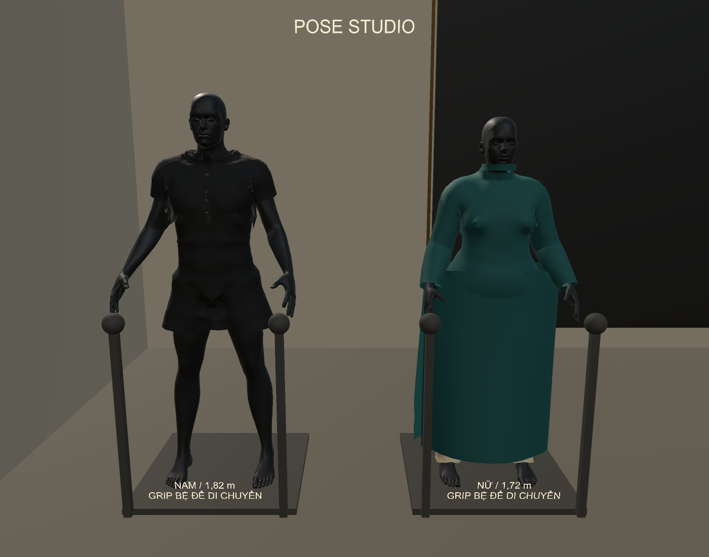
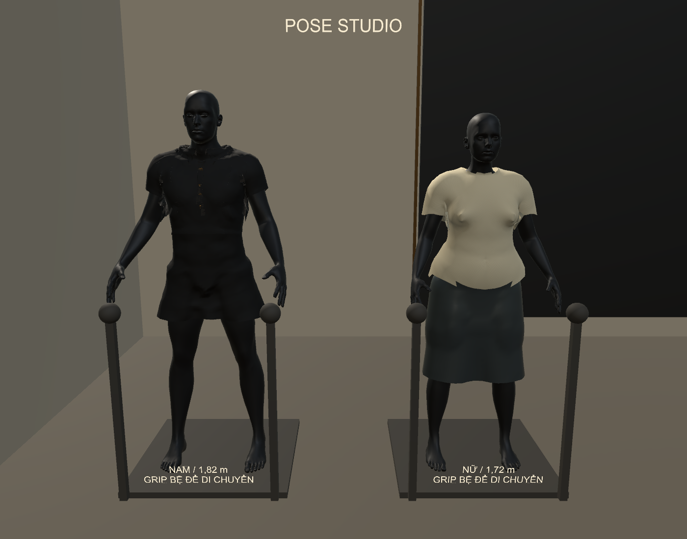

# Áo dài nhiều phần và sửa Grip / áo mannequin pose

Ngày 01/11/2026. Bản `FITTING_READY_V085_LAYERED_GRIP`. Source sửa trực tiếp tại `C:\Users\HUYNH\OneDrive\Desktop\FashionFitPrototype`; game đầy đủ tại `C:\Users\HUYNH\Downloads\FashionFit_Run\FashionFittingRoom.exe`. [Hướng dẫn VR mới](../../Docs/LAYERED_AODAI_VR_GUIDE.md).

## Các lỗi được xử lý

1. **Chạm áo nhưng chọn bệ/khớp:** vùng chọn thân bệ bao cả mannequin thường có khoảng cách bằng 0, giành điểm chạm của áo. VR nay chọn theo mặt tam giác đang thấy, ưu tiên phù hợp trong khoảng gần, bỏ thao tác nắm bệ từ hộp thân lớn. Bệ có hai tay nắm tròn riêng. Khớp ẩn khi chuẩn bị/vào VR; người dùng bật để pose, tắt để chỉnh vải. Ray menu vẫn hoạt động, Grip vải/nón cần gần dưới khoảng 11 cm.
2. **Nón đang đội bị tháo ngay:** Grip thường tạo điểm kéo trên nón, giữ nón ở đầu và duy trì tiếp xúc. Tháo bằng cách thả Grip, giữ Trigger trước rồi bóp Grip. Nón rời vẫn cầm hai tay và rơi bằng Rigidbody khi thả. Nón đang chỉnh tại chỗ cũng được bộ chọn vật liệu nhận diện.
3. **Áo Ivory thiếu vùng vai, kéo cứng:** thay phần thân/vai/tay bằng mặt bao theo hình thể, có cổ/cửa tay mở và skin weights. Áp cho mẫu chính lẫn hai mannequin pose. Mặt áo được làm mịn để không chép các chi tiết da nhỏ lên vải. Tài nguyên đã loại đỉnh không được render; giữ UV và các vật liệu. Không sửa/hide body để qua kiểm tra.
4. **Giới hạn kéo quá nhỏ:** tách khoảng di chuyển xếp vải khỏi phần đàn hồi cục bộ; vật liệu cứng vẫn có phản hồi nhìn được. Cotton và Felt có ngưỡng/phản hồi khác nhau. Hồi theo hàm mũ, có tiếp xúc sau hồi. Số đo áo theo body dùng đoạn đo trên trạng thái mặc vừa; ε RMS có trọng số, vẫn giữ kiểm tra đỉnh giãn để báo vượt miền.
5. **Nhãn cỡ nón dùng chung:** đọc cỡ từ đúng nón đang chọn; đổi mannequin không giữ nhãn sai của nón trước.

## Áo dài đã đưa vào bản chạy

Mặc từ menu trái **ÁO DÀI / LỚP VẢI** sau khi chọn mẫu nhận đồ ở dải bên phải. Có thể mặc trên mẫu chính, pose nữ và pose nam. Áo dài xanh/quần ngà là **mẫu procedural thử nghiệm**, không phải mesh sinh viên nhập, rập truyền thống số hóa hoàn chỉnh hoặc mạng AI mới train.

- Thân/tay áo, cổ đứng, quần hai ống, tà trước và tà sau có đối tượng riêng. Tà mở cạnh, không xẻ giữa tà trước. Các điểm gắn tà được đỡ ở vùng hông; chưa là seam graph may đầy đủ của rập CAD.
- Mỗi tà dùng 13×21 = 273 hạt, lưới tam giác mở, cạnh cấu trúc và liên kết uốn. XPBD/PBD có trọng lực, khối lượng, nhánh kéo/nén, cản, tiếp xúc với cơ thể, quần và tà còn lại. Thân/quần dùng skin + biến dạng nhớt rút gọn; chưa là động lực học vải đầy đủ.
- Chọn Tất cả lớp / Thân-tay / Tà trước / Tà sau / Quần. Lớp khác còn hiển thị/va chạm nhưng không nhận Grip. Hai tay giữ được hai tà khác nhau. Vật liệu đổi riêng lớp đang chọn; chọn tất cả để đổi đồng loạt.
- Kéo tạm rồi thả: rủ xuống và hồi. **Ghim điểm** giữ vị trí xếp bằng ràng buộc ảo; bỏ ghim để trả trọng lực, không gọi đây là ma sát vải thật. Hủy thao tác/tracking loss không tự tạo ghim mới.
- Đổi dài/rộng hai tà là thay đổi kích thước giữ lại. Chưa sửa đường may/chiết/canh sợi hoặc từng rập tùy ý.
- Mẫu chính mặc áo dài giữ fitting và chặn đi bộ. Đã kiểm tra một số pose tay/chân vừa phải; chưa mở chạy nhanh cho áo dài hoặc chứng nhận mọi góc khớp.

## Cơ học và dữ liệu vật liệu

`ε=(L−L0)/L0`, `S=E×h`, `T≈S×ε` (N/m). Nhánh nén có độ cứng thấp hơn để không cư xử như thanh cứng. Hồi theo `u(t)=u_eq+(u0−u_eq)exp(−t/τ)`. Trạng thái cân bằng có tải/tiếp xúc: nón đang đội không co xuyên vào đầu.

Các preset Cotton/Stretch/Felt/Leather dùng E, độ dày, khối lượng diện tích và τ 0,8/1,3/1,8/1,1 giây. **Tất cả là tham số minh họa chưa hiệu chuẩn**, không phải sức bền kéo đứt. Không suy E hay độ bền từ texture. Chưa có rách, biến dạng dẻo, đo lực tay cầm hoặc FEM hoàn chỉnh. ε RMS trên áo là số tổng hợp, khác số cực đại; ngoài miền giả định vẫn cảnh báo và không diễn giải T ngoại suy thành lực đo thật.

Nguồn lý thuyết tham chiếu: [XPBD, bài báo gốc](https://matthias-research.github.io/pages/publications/XPBD.pdf) cho compliance; [MIT: viscoelasticity, Voigt–Kelvin](https://www.ocw.mit.edu/courses/3-071-amorphous-materials-fall-2015/e38e7e85eaa4b138badbf01f673f8435_MIT3_071F15_Lecture7.pdf) cho đáp ứng nhớt và hồi theo thời gian. Mã triển khai của đợt này viết trong dự án, dùng các package Burst/Collections/Mathematics đã có. Không tải dataset mới hoặc train AI trong đợt này.

## Kết quả cuối

| Kiểm tra | Kết quả |
|---|---|
| Grip/lớp/vật liệu qua bộ chọn tay thật trong Editor | 28 mục đạt; 0 exception C# |
| Tương phản vật liệu cùng thao tác | Cotton 316.0 mm / Felt 190.7 mm; là phản hồi ảo |
| EXE Windows với cập nhật/PhysX tự động | 18 mục đạt; 0 exception C# |
| Nón đang đội kéo tại chỗ | offset 104.0 mm; vẫn đội |
| Nón đã kéo ra xa đầu rồi thả | rơi 1.713 m |
| Nhấc tà trước trong EXE | 30.0 cm |
| Hồi tà, RMS so với trước kéo | 75.69 → 0.516 mm |
| Bỏ ghim ảo | điểm tà hạ 22.0 cm |
| Tiếp xúc áo dài độc lập | 7 trạng thái Editor + 5 trạng thái EXE; 415,192 điểm mẫu cơ thể; không có mẫu sâu hơn 1 mm, không có giao cắt cạnh–tam giác giữa 3 cặp lớp đã xét |
| 6 bộ cũ trên hai mannequin | 18 trạng thái, 644,233 điểm mẫu; không có mẫu sâu hơn 1 mm |
| Build Windows | 0 lỗi, 2 cảnh báo |
| Hồi quy VRReady | 37 kiểm tra đạt |
| Hồi quy PoseStudio | 1930 kiểm tra đạt |
| Hồi quy Bimanual | 91 kiểm tra đạt |
| Hồi quy GarmentDoffing | 43 kiểm tra đạt |

Kiểm tra dùng body kín đầy đủ, libigl khoảng cách tam giác và Embree ray parity; đỉnh/tâm mặt/trung điểm cạnh được lấy mẫu. Kiểm tra giữa tà-quần/tà-tà dùng đoạn cạnh hữu hạn giao tam giác theo hai chiều. Có SHA256 từng mesh xuất. Không gọi phép chiếu của solver để tự chấm điểm. Các trường hợp áo dài gồm mẫu chính/nam/nữ đứng, kéo tà, hồi, đổi ngắn-rộng, gập chân/tay và bỏ ghim. Đây là các trạng thái hữu hạn, không là chứng minh liên tục hay mọi kiểu nếp gấp. Chưa kiểm định tự va chạm trong cùng một tà và mọi vùng chồng bodice/tà như một bài toán may nhiều lớp đầy đủ.

## Hiệu năng và phạm vi chưa hoàn tất

Bộ giải tà/tiếp xúc chuyển sang Burst, ngủ khi ổn định và bỏ đỉnh mesh không dùng. Bản managed trung gian có lần cập nhật ~305 ms đã bị loại. Editor cuối ghi 22.58 ms ở các mẫu đo. EXE desktop chẩn đoán ghi frame trung bình 0.90 ms, P95 10.19 ms, cập nhật lớp cao nhất 16.80 ms. Cửa sổ ẩn, giới hạn đồng bộ và tải máy ảnh hưởng số đo; không quy ra FPS trong kính.

Giới hạn tối đa một tick tà nhỏ cho mỗi lần render update để tránh dồn nhiều tick khi quá tải. Khi máy không theo kịp, vải chậm lại; τ của tà theo thời gian mô phỏng. Render/đầu kính không bị cố định về tần số cloth. Vẫn có spike khi dựng đồ/đổi khớp; chưa xác nhận ngân sách 72/90 Hz với kính thật.

Input kiểm tra tiêm trạng thái Touch/owner nhưng đi qua đúng đường overlap/near-surface của tay. **Chưa có xác minh HMD/Touch vật lý**; phiên desktop có thể ghi `XR_ERROR_FORM_FACTOR_UNAVAILABLE`. Thân áo theo body dùng xấp xỉ đàn hồi nhớt và võng cân bằng, không có đầy đủ uốn/shear/air dynamics như solver tà. Thử gió cho thân áo mới chưa được tích hợp. Cởi bằng nút vẫn là blouse thử riêng, chưa áp cho áo dài. Chưa tự chuyển mọi FBX/GLB/OBJ của sinh viên thành đồ nhiều lớp có rập.

## Xác minh sau khi cập nhật thư mục game

Sau khi người dùng thoát game cũ, đã thay đúng EXE và dữ liệu tại FashionFit_Run, đối chiếu SHA256 đủ 175 tệp player. Source có 78 tệp thay đổi ở lần triển khai, giữ bản trước ở thư mục lưu trữ ngoài OneDrive. Giữ nguyên lối mở Desktop → FashionFit VR → 01 - VAO GAME VR.

Đã chạy lại chính EXE vừa cài: 18/18 kiểm tra đạt, 0 exception C# của kịch bản. Xuất 5 trạng thái thực của lượt này và đo lại độc lập: không có mẫu cơ thể sâu hơn 1 mm hoặc giao cắt cạnh–tam giác giữa các cặp tà/quần đã xét. `actual_player.json`, `actual_player_contact.json` và `deployment.json` lưu kết quả. Không xác nhận đây là một phiên kính vật lý.
