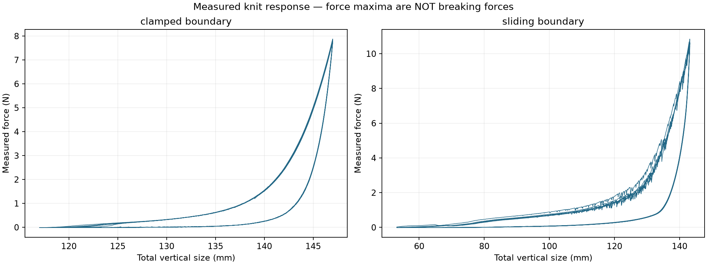
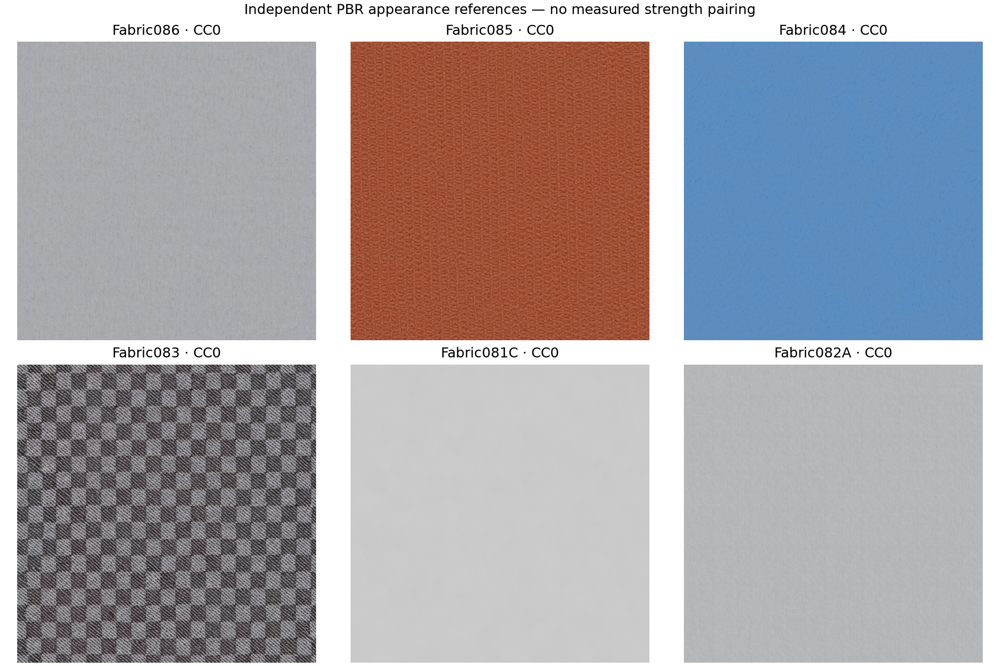

# Dữ liệu texture và cơ học vải

Đợt bổ sung 29/10/2026, lưu trực tiếp trong dự án Desktop. Tải nguồn ngoài `Assets`, xác minh dữ liệu rồi tạo tài liệu/công cụ đọc. Không huấn luyện model mới và không thay thông số vật lý đang chạy trong Unity.

## Dữ liệu đã lấy

| Nguồn gốc | Nội dung đã lưu/kiểm tra | Phạm vi |
|---|---|---|
| [ambientCG](https://ambientcg.com/) | Fabric086, 085, 084, 083, 081C, 082A; **6 ZIP 1K-PNG / 40 map** | PBR bề mặt; [CC0](https://docs.ambientcg.com/license/) |
| [Eurographics 2024, nguồn tác giả](https://henardoel.github.io/henardoel/index_eg2024.html) / [kho EG](https://diglib.eg.org/items/41871095-8ae2-453f-a210-49e4e5febc5f) | ZIP gốc **673.630.805 byte**, hai CSV, manifest ảnh đọc trực tiếp từ ZIP | Nghiên cứu học thuật theo [bài báo](https://onlinelibrary.wiley.com/doi/10.1111/cgf.15029); chưa coi là tài sản thương mại/CC0 |
| [Zenodo 17075127](https://zenodo.org/records/17075127) | Lực–kích thước theo thời gian, thông tin ảnh và tọa độ mũi đan; không lấy bộ ảnh 275 MB | CC BY 4.0; Poincloux, Adda-Bedia, Lechenault, [PRX 2018](https://doi.org/10.1103/PhysRevX.8.021075) |
| MIT/Berkeley đã có | Giữ lại nguồn khối lượng/uốn và tài liệu phi tuyến trong `Data/Physics/` | Không tải trùng; xem [báo cáo cũ](../../AI/ClothData/PHYSICS_COLLECTION_REPORT.md) |

Texture có color, normal, roughness, displacement và các map bổ sung tùy gói. Có cả normal OpenGL/DirectX, không coi chúng là hai chất liệu. Bốn gói có creation method `PBRMultiAngle`, hai gói `PBRProcedural`; không gọi toàn bộ là các mẫu vải đã đo vật lý. `texture_catalog.json` để trống liên kết mẫu cơ học và sức bền vì chưa có phép đo cùng mẫu.

Tổng dữ liệu trước đợt này: **28.861.827.322 byte**. Sau thu thập và chuẩn bị: khoảng **29.755.331.840 byte = 29,76 GB**, dưới ngân sách 30 GB; tăng khoảng **893,5 MB**, còn khoảng 244 MB. Ảnh và cảnh mô phỏng EG nằm trong ZIP, không lưu thêm một bản giải nén đầy đủ. Bộ video MIT nhiều GB và ảnh sliding 275 MB chưa tải.

## Kết quả kiểm tra nhãn — điểm quan trọng trước khi train

CSV thực tế có **1.275 mẫu train và 194 mẫu test = 1.469 mã mẫu**, khác số 1.565 mô tả trong bài báo. Đã đọc đúng CSV test có nhiều hàng header, không nhầm các hàng header thành mẫu vải.

Đã xác minh **2.938 ảnh trước/sau** được tham chiếu: không thiếu ảnh, ảnh đọc hợp lệ, không trùng byte giữa hai split trong các ảnh này. Không có ID dùng chung giữa train và test. Đây chưa phải chứng nhận không tồn tại hai mẫu vải có cùng nguồn hoặc rất giống nhau.

Các cột `*_MechMet`, `*_MechIm` và `pred_*` là **dự đoán mô hình**, không phải phép đo thí nghiệm. `nmae_*` là sai số. Kho có **195 cảnh GT**: 194 khớp bộ test; một mã `SED-0334` không có trong hai CSV. **Không có GT train tương ứng** trong gói đã phát hành này.

Đã giữ riêng:

- `metadata_raw`: thông tin đầu vào nguồn, chưa tự đoán đơn vị cho các trường không được xác minh.
- `model_outputs_not_measured_labels`: dự đoán và trường đánh giá nguồn.
- `simulation_reference`: tham số GT từ cảnh nguồn, có tên thành viên ZIP để truy vết. Đây là tham số theo mô hình mô phỏng nguồn; không phải lực đứt hoặc compliance Unity đã hiệu chuẩn.
- `measured_failure`: lực đứt, giãn tại đứt, lực xé, mài mòn đều `null`.
- `approved_supervised_training=false`: không tự đẩy dữ liệu này vào bài toán huấn luyện sức bền. Hàm đọc nhãn train có kiểm tra và từ chối khi chưa có nhãn đo được duyệt.

Nếu cần distillation từ MechMet/MechIm, đó phải là thí nghiệm riêng có nhãn teacher rõ ràng. Muốn train có giám sát bằng phép đo cần bổ sung GT train từ tác giả hoặc phép đo của chính dự án; không lấy 194 mẫu test làm train.

## Lực kéo dệt kim đã chuẩn hóa

Theo README của tác giả, cột có header `extension [mm]` thực chất là **tổng kích thước dọc của mẫu**. Đã đổi mm → m và giữ lực N, thời gian s. Không chuyển chiều cao thành strain hoặc tự suy ra Young modulus khi chưa có reference/gauge length và tiết diện phù hợp. Giữ nguyên offset lực âm nhỏ trong nguồn.

| Điều kiện | Số dòng đo | Chiều cao mẫu trong thí nghiệm | Miền lực quan sát |
|---|---:|---:|---:|
| Clamped, 51 × 51 mũi | 60.115 | 116,996–147,004 mm | −0,01749 đến 7,87711 N |
| Sliding, 20 × 30 mũi | 18.141 | 53,096–143,165 mm | −0,018 đến 10,849 N |

Tổng **78.256 dòng**, thuộc một hệ vật liệu dệt kim và hai điều kiện/kích thước mẫu; không phải 78.256 loại vải. Không so sánh lực hai mẫu như độ bền nội tại vì hình học và điều kiện biên khác nhau. Các cực đại trên không được gán thành lực đứt. Đồ thị thể hiện đường tải–thả để phục vụ hiệu chỉnh phản ứng phi tuyến/hồi phục.

## Liên hệ với project hiện tại

`cloth-materials.json` đang có ba profile; khối lượng bề mặt lấy từ MIT, độ uốn là tham chiếu tương đối, còn kéo dọc/ngang, shear, damping, friction, air drag và roughness đang được đánh dấu authored. Thu thập thêm texture không biến các hệ số đó thành số đo thực.

SHA-256 của catalog vật lý trước/sau chuẩn bị đều là `b59e9d6e8ebd0801362a194fe70988315880157a8d64a91afd4e9e2406d958a4`. Không sửa cloth solver, skinning, nguồn trang phục hoặc chuyển động VR trong đợt này. Không cần chạy lại Unity cho các dữ liệu nằm ngoài Assets.

Đề xuất tiếp theo: chọn một mẫu vải thật, ghép ảnh/PBR đúng mẫu với đường đo kéo/uốn; dựng swatch ảo cùng khối lượng, hình học và điều kiện kẹp; fit tham số solver và kiểm tra khi đổi timestep/mật độ lưới. Chỉ sau khi khớp phép đo mới đưa profile vào trang phục 3D, kiểm tra đứng yên/kéo-thả và tăng tốc trình diễn. [XPBD gốc](https://matthias-research.github.io/pages/publications/XPBD.pdf) có ước lượng lực constraint, nhưng phải xác nhận cách áp dụng trong solver hiện có.

Để phát triển **độ bền phá hủy**, còn cần dữ liệu thử đến đứt/rách, hướng sợi, độ bền đường may, điều kiện môi trường và tốc độ thử được ghi rõ. Các dữ liệu mới hỗ trợ bề mặt và phản ứng cơ học, chưa chứng nhận sức bền hoặc mô phỏng rách đáng tin cậy.

## File để sử dụng

- [Trang xem texture và đồ thị](../../AI/MaterialLab/index.html).
- [Hướng dẫn và lệnh chạy lại](../../AI/MaterialLab/README.md).
- Raw: `AI/ClothData/Data/MaterialLab/Raw/`.
- PBR: `AI/ClothData/Data/MaterialLab/Textures/`.
- Dữ liệu đọc được: `Prepared/material_samples.jsonl`, `Prepared/*_force_SI.csv`, `Prepared/simulation_GT_reference.json`.
- Audit/checksum: `collection_manifest.json`, `texture_catalog.json`, `Prepared/eg2024_audit.json`, `Prepared/verification.json`.

Raw và bản chuẩn bị trong `AI/ClothData/Data/` đã được `.gitignore` loại khỏi public repository. Báo cáo này không cấp lại giấy phép cho dataset; giữ thông tin tác giả và giấy phép từng nguồn khi dùng hoặc chia sẻ.
