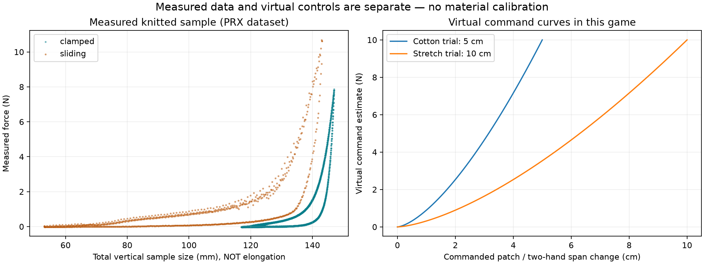
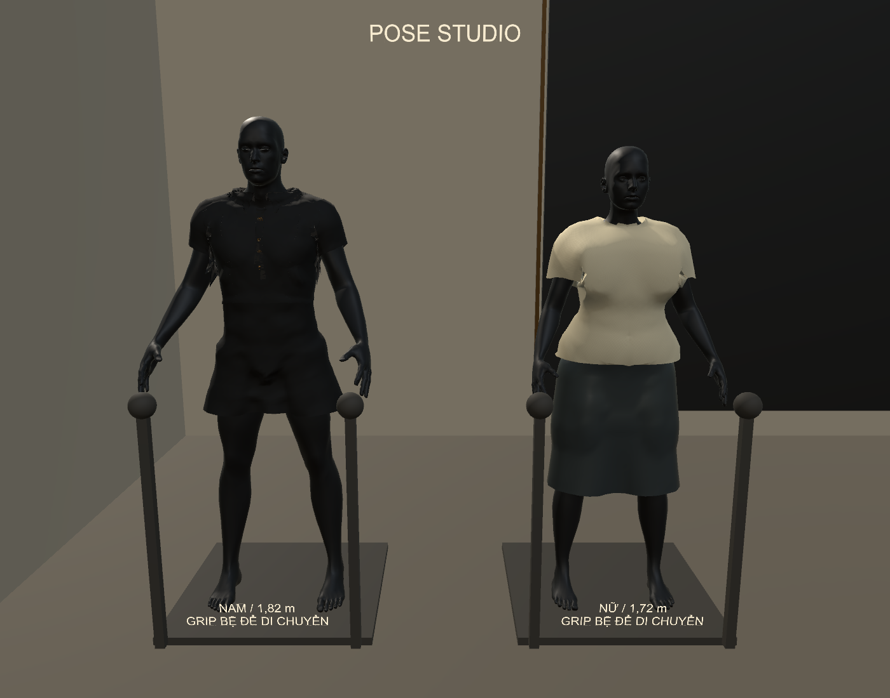

# Sửa pose, Grip nón và đáp ứng vật liệu — V086

Ngày 01/11/2026. Mã nhận diện `FITTING_READY_V086_POSE_BALANCE`.

Source: `C:\Users\HUYNH\OneDrive\Desktop\FashionFitPrototype`.
Game: `C:\Users\HUYNH\Downloads\FashionFit_Run\FashionFittingRoom.exe`.
[Cách dùng VR](../../Docs/POSE_BALANCE_VR_GUIDE.md). Chỉ coi bản đã được thay trong thư mục game khi `deployment.json` ghi passed; kết quả chạy tại đường dẫn thật lưu riêng sau cập nhật.

## Đã sửa

- Thêm nút POSE / VẢI ở đầu bảng Y và trang phục desktop. Trong POSE, tay chọn khớp/bệ; trong VẢI, chọn đúng bề mặt. Giữ lựa chọn pose khi khởi tạo UI VR, không âm thầm ẩn khớp. Hai tay điều khiển hai khớp và nhả riêng; bệ có hai tay nắm.
- Grip thường nhấc nón đang đội. Trigger + Grip là chỉnh tại chỗ. Khi hai tay giữ nón, chuyển động trung điểm/xoay được tách khỏi thay đổi khoảng cách hai điểm cầm; di chuyển cả nón không biến thành kéo giãn. Một tay nhả vẫn giữ nón; tay cuối nhả thì có trọng lực.
- Giới hạn điều khiển Cotton 5 cm / Stretch 10 cm / Felt 2,5 cm / Leather 2 cm; có nhánh nén và hồi theo thời gian. Thêm cạnh XPBD với khối lượng gộp từ diện tích tam giác; hiệu chỉnh hai đầu ngược chiều theo nghịch đảo khối lượng. Giữ các vòng tiếp xúc sau ràng buộc.
- Vật liệu truyền đúng giới hạn kéo sang áo mẫu chính. Bảng vật liệu ghi rõ giới hạn thử và lực lệnh ảo. Áo Ivory được tái dựng phần bao vải ngực rộng hơn và làm đều gấu, không sửa/ẩn cơ thể để che xuyên vải. Mẫu vẫn là mesh procedural, chưa có chất lượng may đo hay quang thực.

## Mô hình và giới hạn vật lý

Biến dạng chuẩn hóa `ε=(L-L0)/L0`; lực căng màng xấp xỉ `T=E h ε` đơn vị N/m. Các tham số E/h minh họa cũ chưa hiệu chuẩn. Lệnh tương tác riêng `F_cmd=10 × clamp(|ΔL|/limit,0,1)^1.5` N, đối nhau ở hai điểm giữ nón. Đây là tải ảo do người dùng ra lệnh, **không phải lực đo từ Touch**, không phải đường thực nghiệm được fit. Tổng phản lực hiển thị là cách hạch toán tải của mô hình rút gọn, không phải phép đo cân bằng Newton/FEM toàn bộ hệ.

Thân áo dùng skin + trường biến dạng nhớt, trọng lực dạng độ võng và các cạnh XPBD chỉ chống kéo dài; nén được phép tạo nếp. Điểm đỡ cơ thể/đường treo cung cấp đối lực một tay, mannequin được gắn trên bệ. Tà áo dùng solver hạt XPBD với trọng lực; nón rời dùng PhysX Rigidbody. Không mô phỏng ragdoll đổ, đứt vải, dẻo vĩnh viễn hoặc tất cả tự va chạm. Hồi theo `u_eq+(u0-u_eq)exp(-t/τ)`, về trạng thái có tải/tiếp xúc chứ không co xuyên đầu. Hồi tà theo thời gian solver; nếu máy quá tải, số tick vải bị giới hạn và vải chậm lại.

Giới hạn 5/10 cm là hành trình điểm kéo trên thân, hoặc **tổng** thay đổi span hai tay trên nón. Không phải khoảng dịch chuyển tự do của tà áo, cũng không phải tuyên bố cotton thật luôn giãn 5 cm. Cần chiều dài chuẩn, bề rộng, hướng sợi, cấu trúc dệt, lực, tốc độ và chu kỳ tải để hiệu chuẩn một loại vải.

## Dữ liệu đã kiểm tra

- Đối chiếu **1.469 bản ghi** tại archive có sẵn của [Practical Methods to Estimate Fabric Mechanics from Metadata, EG2024](https://henardoel.github.io/henardoel/index_eg2024.html). Có **193 mẫu cotton gần nguyên chất: 151 dệt thoi, 42 dệt kim**. Bài báo mô tả corpus lớn hơn; số ở đây là các dòng trong archive thực tế trên máy. Tham số dự đoán/simulation không phải nhãn kéo đứt thực nghiệm; không tự chuyển thành nhãn huấn luyện đã kiểm duyệt.
- Kiểm tra **78.256 dòng đo lực–kích thước** từ [Poincloux và cộng sự, dữ liệu Geometry and Elasticity of a Knitted Fabric](https://zenodo.org/records/17075127), CC BY 4.0: 60.115 clamped + 18.141 sliding. Cột chiều dài là **tổng kích thước dọc mẫu**, không phải độ giãn từ chiều dài tự nhiên. Chưa suy E/strain hoặc sức bền khi thiếu chuẩn tham chiếu. Hai điều kiện biên giữ riêng; SHA256 và thống kê trong `material_research.json`.
- Tên phương pháp tham khảo: [ASTM D5035 — strip breaking force/elongation](https://store.astm.org/standards/d5035), [ASTM D2594 — stretch and recovery knitted fabrics](https://store.astm.org/standards/d2594). Không sao chép toàn văn tiêu chuẩn trả phí. Không dùng tên cotton làm một hằng số cm chung.
- [XPBD — bài báo gốc](https://matthias-research.github.io/pages/publications/XPBD.pdf) là cơ sở ràng buộc có compliance; code triển khai trong dự án. Không tải trùng dữ liệu lớn, không train một mạng AI mới trong đợt này và chưa fit preset runtime với các đường đo.

## Kiểm chứng

| Kiểm tra | Kết quả |
|---|---|
| Editor thao tác POSE, nón, kéo/nén | 29 mục đạt, 0 exception |
| EXE: cùng đường near-pick, ray nút mode, injected Touch, bước vật lý thủ công | 29 mục đạt, 0 exception |
| EXE tự cập nhật PhysX/vải/lớp | 18 mục đạt, 0 exception |
| Di chuyển khớp qua hai tay | 18.0 cm ở trường hợp cổ tay thử |
| Chuyển động hai tay cùng hướng, sai số hình nón | 0.00017 mm |
| Span nón Cotton / Stretch | 5.00 / 10.00 cm |
| Điểm áo Cotton / Stretch | 5.00 / 10.00 cm |
| Áo hồi, sai lệch điểm sau thả | 0.050 mm |
| Nón rời rơi trong EXE tự cập nhật | 1.713 m |
| Tà nâng và hồi RMS | 30.0 cm; 76.49 → 0.94 mm |
| Sáu bộ native, nam/nữ | 61 kiểm tra, 18 trạng thái tiếp xúc; 644,662 điểm mẫu |
| Áo dài / lớp | 28 Editor; 7 trạng thái Editor + 5 EXE; 415,192 điểm mẫu cơ thể |
| VRReady / Bimanual | 37 / 91 kiểm tra đạt |
| Build Windows | 0 lỗi, 2 cảnh báo optional OpenXR (PoseControl/StickControl) |

Kiểm tra tiếp xúc độc lập dùng body nguyên vẹn, libigl khoảng cách tam giác + Embree ray parity, lấy mẫu đỉnh/tâm mặt/trung điểm cạnh. Các trạng thái trên không có mẫu sâu hơn 1 mm. Ba cặp lớp tà/quần được kiểm tra giao cạnh hữu hạn–tam giác hai chiều, không thấy giao trong các trạng thái đã xuất. SHA256 mesh đi kèm; không gọi solver để tự chấm. **Không chứng nhận mọi tư thế, tự va chạm hoặc va chạm liên tục**. Chưa có phiên kiểm chứng kính/Touch vật lý trong đợt này; input được tiêm vào đúng đường chọn tay/nút của game.

Thời gian một số cập nhật lớp cao nhất trong phép thử EXE: 38.71 ms; không suy thành FPS VR. Việc đổi đồ hoặc pose có thể có spike; chưa chứng nhận 72/90 Hz trên Quest Link.

