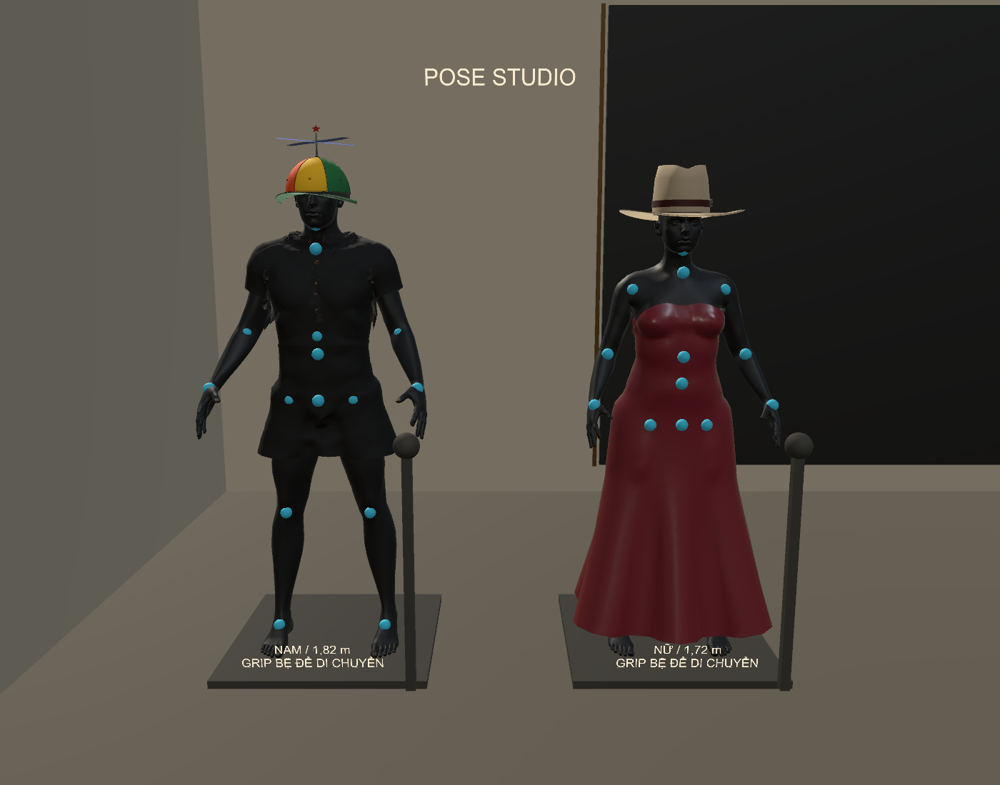

# Báo cáo mannequin pose và vật liệu đàn hồi

Ngày 01/11/2026. Sửa trực tiếp source `C:\Users\HUYNH\OneDrive\Desktop\FashionFitPrototype`; EXE đầy đủ tại `C:\Users\HUYNH\Downloads\FashionFit_Run\FashionFittingRoom.exe`. [Cách thử bằng hai tay VR](../../Docs/POSE_MATERIAL_VR_GUIDE.md).

## Đã triển khai

- Hai mannequin pose nam/nữ mặc độc lập sáu bộ procedural hiện có, tạo 12 tài nguyên từ mesh đầy đủ. Giữ UV, submesh, vật liệu, cổ áo/nẹp/nút của mẫu gốc. Mặc định nữ Ivory, nam bộ cổ polo; chưa phải bộ menswear may riêng.
- Chọn đúng avatar trên menu VR/desktop; thả mẫu gần thân hoặc nón gần đầu chọn avatar gần nhất. Ba nhân vật đội nón độc lập. Nón bám xương đầu khi pose, đồ bám khớp và đi cùng bệ.
- Hai Grip độc lập trên vải; hai tay nón vừa điều khiển vật cầm vừa kéo/nén cục bộ. Thả một tay giữ tay còn lại; thả tay cuối ở xa đầu có trọng lực Rigidbody.
- Vùng đầu đo từ mesh từng người, có hơn 64 điểm hỗ trợ và khung bám xương đầu. Cỡ nón và vòng miệng quyết định độ giãn; đỉnh và mép tam giác được đẩy khỏi vùng đầu. Tháo nón giữ biến dạng tức thời rồi hồi dần.
- Preset riêng từng đối tượng: Cotton/Stretch/Felt/Leather. Menu hiện giãn/nén %, lực màng T≈N/m, cảnh báo ngoài miền đàn hồi giả định. Texture không được coi là dữ liệu E hay độ bền.
- Pose dùng trường khoảng cách cơ thể 8 mm, skin nghịch đảo, 10 proxy chi/bàn chân hoạt động khi chi di chuyển, biên tiếp xúc 20 mm và mẫu tâm/mép tam giác. Giữ toàn bộ cơ thể để kiểm tra, không che da nhằm vượt kiểm tra.
- Gấu váy treo chủ yếu từ hông; không gắn chặt vào xương cổ chân. Chuyển hình thể dùng trường dịch chuyển của body tương ứng để giảm điểm nhọn do xoay từng mặt tam giác nhỏ. Va chạm chi không đẩy phồng hông/vai ở tư thế nghỉ.
- Job Burst dùng các package đã có sẵn, bộ nhớ NativeArray được quản lý theo vòng đời; cloth pose cập nhật tối đa 30 Hz và ngủ khi ổn định. Render/đầu kính không bị đặt về 30 Hz. Váy chính giữ bộ giải PBD/XPBD có trọng lực và va chạm.

## Cơ học và giới hạn diễn giải

`ε=(L−L0)/L0`, `S=E×h`, `T≈S×ε` (N/m). Nhánh nén mềm hơn nhánh kéo. Trên váy PBD/XPBD, E và chiều dày được chuyển thành compliance của cạnh khi bật mô hình mới. Pose/nón dùng đáp ứng đàn hồi nhớt rút gọn và kernel tương tác không gian; không phải mô hình FEM có đầy đủ đường may, shear, wrinkling hay tự va chạm.

`u(t)=u_eq+[u(0)−u_eq]×exp(−t/τ)`, τ từ 0,8 đến 1,8 giây tùy preset. Trạng thái cân bằng có tải/tiếp xúc: nón đang đội không co xuyên đầu. Công thức mũ có nền tảng ở mô hình đàn hồi nhớt; triển khai này là xấp xỉ cho tương tác thời gian thực, không xác nhận mô hình toàn vật liệu. [MIT: viscoelasticity và Voigt–Kelvin](https://www.ocw.mit.edu/courses/3-071-amorphous-materials-fall-2015/e38e7e85eaa4b138badbf01f673f8435_MIT3_071F15_Lecture7.pdf).

Compliance của bộ giải chính dựa trên ý tưởng XPBD để tách độ cứng khỏi số vòng lặp tốt hơn. [Bài báo gốc XPBD, Macklin/Müller/Chentanez 2016](https://matthias-research.github.io/pages/publications/XPBD.pdf). Không sao chép một solver bên ngoài vào dự án ở đợt này.

Các giá trị E, h, mật độ, tải kéo ảo và miền đàn hồi là **tham số minh họa chưa đo/hiệu chuẩn**, không phải sức bền kéo đứt. Chưa có plasticity/rách/hỏng vĩnh viễn, không đo lực tay cầm, không chứng nhận độ bền nón/vải. Hướng sợi được xấp xỉ theo hướng cạnh trong hệ mannequin, chưa lấy warp/weft từ rập/UV may thực. Muốn dự báo sản phẩm thật cần mẫu đo lực–giãn theo hai hướng, uốn, ma sát, trễ tải–dỡ tải và điều kiện thử.

## Kết quả kiểm tra

| Kiểm tra | Kết quả |
|---|---|
| Chức năng mới trong Unity Editor | 61 kiểm tra đạt; 0 exception |
| Tài nguyên trang phục | 12 bộ nam/nữ; bản full mesh, không dùng thumbnail tủ đồ |
| Tiếp xúc độc lập | 18 trạng thái, 646,093 điểm mẫu tổng; không có mẫu sâu hơn 1 mm trong các trạng thái đã xuất |
| EXE Windows | 16 kiểm tra đạt; 0 exception C# trong kịch bản; PhysX FixedUpdate |
| Nón rơi thực trong EXE | 1.873 m sau thả; không dùng Physics.Simulate thủ công |
| Nón hồi trong EXE | offset 65.00 → 0.098 mm |
| Vải pose hồi trong EXE | RMS so với cân bằng 8.17 → 0.824 mm |
| Cotton so với Felt, cùng thao tác | 70.00 / 11.99 mm |
| Váy chính hồi | RMS 28.33 → 0.385 mm |
| Tạo Windows build | 0 lỗi; 2 cảnh báo Unity |
| Hồi quy Bimanual | 95 kiểm tra đạt |
| Hồi quy PoseStudio | 1930 kiểm tra đạt |
| Hồi quy VRReady | 36 kiểm tra đạt |
| Hồi quy GarmentDoffing | 43 kiểm tra đạt |

Kiểm tra tiếp xúc dùng libigl khoảng cách đến tam giác chính xác và Embree phân loại trong/ngoài bằng ray parity của body kín đầy đủ. Mẫu gồm đỉnh, tâm mặt và trung điểm cạnh; lưu SHA256 từng mesh xuất trong `independent_contact.json`. Đây là kiểm tra độc lập với SDF đang điều khiển vải, không dùng cùng phép chiếu để tự chấm điểm.

Các trạng thái gồm cả 12 trang phục nghỉ, thêm nữ/nam look 2/5/6 khi xoay vai và gập chân. Phát hiện mép áo/bàn chân xuyên ở bản trung gian đã được sửa rồi xuất/đo lại. Không suy rộng thành bảo đảm liên tục, mọi pose, tự va chạm hoặc tốc độ chạy bất kỳ.

Nón cố ý giảm xuống 80% trên đầu nam có giãn cực đại 56.3%: đã được đánh dấu ngoài miền tuyến tính; không coi giá trị lực ngoại suy là đo sức bền. Tăng cỡ 110% giảm đáng kể độ căng trong kiểm tra. Kiểm tra hồi mũ ở 30/60/90 Hz đều đạt.

Trong chẩn đoán EXE desktop cửa sổ 1280×900, preset VR nhẹ, frame trung bình 2.02 ms, P95 9.02 ms; lần cập nhật pose cao nhất 27.46 ms. Đây không phải FPS trong kính; cửa sổ ẩn/vsync và tải máy ảnh hưởng số đo. Khi kéo bộ nhiều chi tiết/đổi khớp vẫn có spike, chưa xác nhận đạt ngân sách 72/90 Hz trên Quest Link. Editor cao nhất 23.88 ms cho một pose update.

Chạy phần mềm thật và PhysX, nhưng input Grip được tiêm bằng hai owner thử nghiệm; **chưa có buổi xác minh tay cầm/kính vật lý**. Cần thử đúng PC/kính: đi tới từng mẫu, nắm hai bên nón, tháo/thả, kéo hai điểm gấu váy, đổi khớp và di chuyển bệ. Giữ nguyên khả năng cởi blouse trên mẫu chính; chưa tự cởi các bộ pose hoặc tự căn mọi FBX/GLB/OBJ sinh viên.

Tài nguyên được tạo từ body/đồ đã có trong dự án, không tải dataset và không huấn luyện mạng AI trong đợt triển khai này. Không thêm thư viện bên ngoài vào bản game. Các nguồn body cũ vẫn theo thông báo của dự án.

## Xác minh sau cập nhật

Đã chạy lại chính `Downloads/FashionFit_Run/FashionFittingRoom.exe` sau khi chép: 16 kiểm tra đạt, mặc mặc định đúng, hai tay nón/vải, hồi phục và nón rơi theo PhysX đạt. `actual_player.json` lưu kết quả. Đối chiếu SHA256 đủ 175 tệp player với bản đã build; giữ nguyên launcher/Desktop hub. Lưu bản trước trong thư mục `_Luu_tru/Phat_trien_2026-11-01/PoseMaterial/BeforePlayer` ngoài OneDrive.

OpenXR ở phiên kiểm tra desktop trả `XR_ERROR_FORM_FACTOR_UNAVAILABLE`: kính không sẵn sàng trong phiên tự động đó. Số exception bằng 0 ở các bảng trên là exception C# của kịch bản, không có nghĩa đã xác nhận một phiên OpenXR/kính thành công. Khi thử thật cần mở Quest Link trong kính rồi bấm Vào VR; chưa đưa ra kết luận về cảm giác kéo hoặc tốc độ khung hình trong kính.
