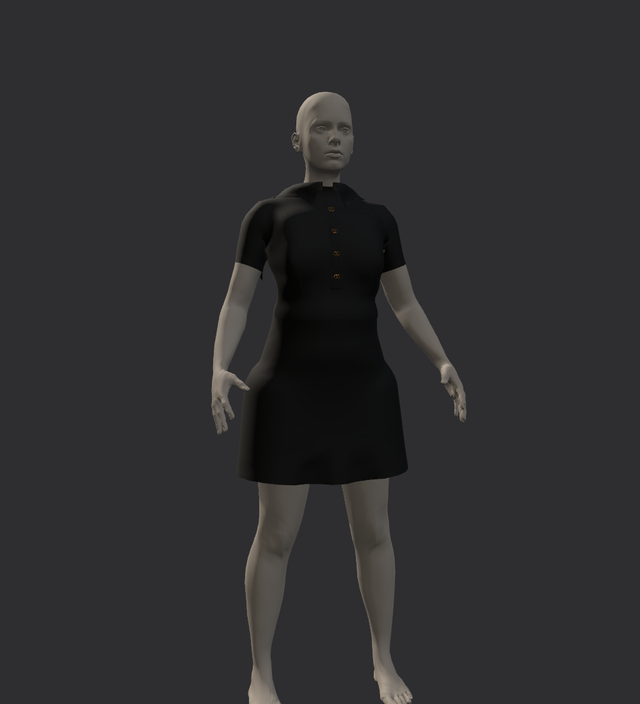
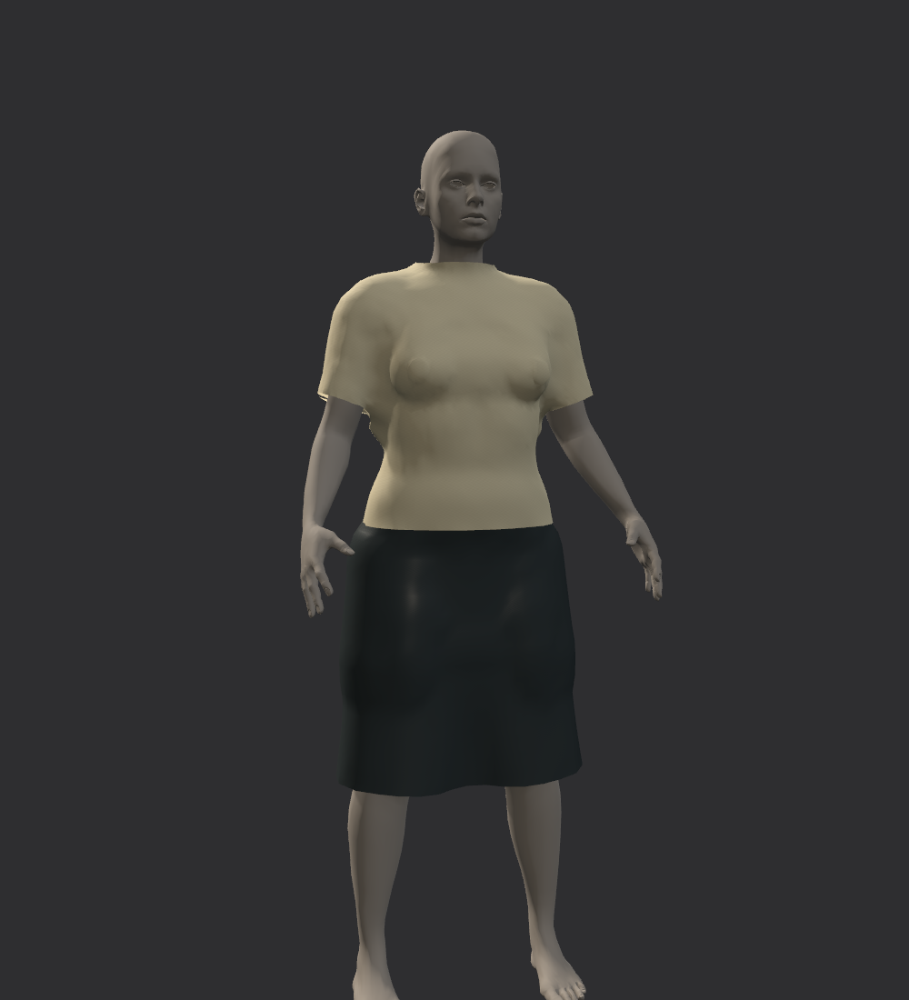
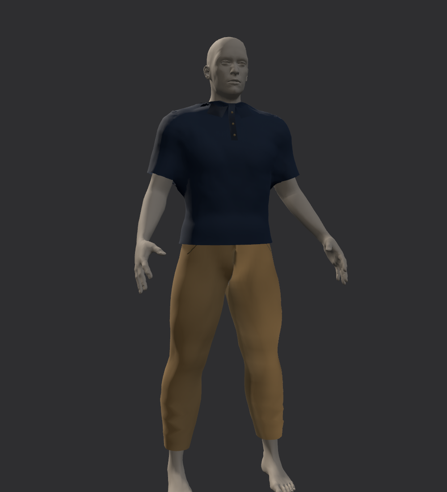

**Kết quả luồng nhận trang phục 3D theo body mẫu — 3/11/2026**

Đã bổ sung hàm StudentGarmentPipeline.Process(frame, spec), cửa sổ nhận bài sinh viên và điểm vào batch. Source được cập nhật trực tiếp tại FashionFitPrototype. Phần thay đổi này nằm trong Unity Editor và công cụ QA. Game đang cài vẫn là V092.

Hàm nhận mesh 3D đã import vào Unity, body nguồn và submission.json. Nhánh canonical đối chiếu body nguồn với body tham chiếu bằng vị trí đỉnh và mặt có hướng. Có hỗ trợ đổi thứ tự đỉnh và tách đỉnh UV ở body. Sau khi xác nhận, mesh trang phục được chuyển bằng phép đổi hệ tọa độ khai báo. Sai số giữ hình được đo trước khi cho xem tĩnh.

Ba bộ tham chiếu đã được tạo cho mannequin nữ chính, nữ pose và nam pose. Mỗi bộ có OBJ để mở trong phần mềm thiết kế, JSON có mã phiên bản body và prefab Unity chứa SourceBody cùng nhánh Garment.

| Luồng đầu vào | Xử lý hiện có |
|---|---|
| Đồ thiết kế trên body mẫu | Kiểm tra body đầy đủ, giữ hình học trang phục sau đổi tọa độ, chuyển trọng số xương, kiểm tra chi tiết và tiếp xúc |
| Body đã đăng ký cùng topology | Tái sử dụng GarmentSurfaceTransfer hiện có, chuyển theo cặp body và đo độ méo so với đầu vào |
| Body lạ chưa đăng ký, pose/đơn vị sai hoặc thiếu vật liệu | Từ chối với mã lỗi cụ thể |

Công cụ giữ các kênh UV, màu đỉnh, submesh, chi tiết mesh và dữ liệu vật liệu của bản Unity đã import. Khi lưu, gói sở hữu bản sao vật liệu và nguồn texture 2D. Ảnh không đọc được ở runtime được sao chép qua asset/importer gốc. Ảnh nhúng GLB được tìm lại bằng local file ID của bản sao.

Các ngưỡng duyệt ban đầu được chọn ở mức 0,1 mm cho đối chiếu body, 1 mm cho mẫu xuyên tĩnh và 5% cho thay đổi chiều dài cạnh trang phục. Ngưỡng 5% là chính sách duyệt hình học ban đầu, cần hiệu chỉnh theo yêu cầu bài nộp. Hiệu chuẩn cơ học vật liệu vẫn cần dữ liệu đo riêng.

Bộ nhận bài đạt 162 kiểm tra với 21 tình huống. Bộ full đạt 20 bước, gồm các hồi quy khớp, hai tay, phom, đồ nam, áo dài và build Windows. Điểm vào batch đã chạy qua một GLB nhập thật trong Unity, lưu gói thành công và dọn đúng asset QA tạm.

| Đích | Đỉnh trang phục trong fixture | Sai số giữ hình lớn nhất | Đổi chiều dài cạnh |
|---|---|---|---|
| fitting-female | 15,471 | 0.000000 mm | 0.000000% |
| pose-female | 7,821 | 0.000000 mm | 0.000000% |
| pose-male | 8,694 | 0.000000 mm | 0.000000% |

Các ca đổi thứ tự/tách đỉnh UV, frame đặt nơi khác trong Scene và đơn vị centimet đều đạt. Tám ca dữ liệu lỗi được từ chối đúng lý do. Ca body co 2% được chuyển qua cổng tĩnh. Ca co 10% làm cạnh trang phục thay đổi khoảng 11,1% và được chặn ở NEEDS_REVIEW.

Kiểm tra tiếp xúc độc lập đạt 12 bản chuyển. Tổng 626,551 mẫu gồm đỉnh, tâm mặt và trung điểm cạnh được đo với body đầy đủ. Không có mẫu xuyên sâu hơn 1 mm trong các ca này.

Đã kiểm tra 9 liên kết texture bằng mẫu GPU 32×32 trước và sau lưu. Sai số lớn nhất đo được là 0.0. Các thuộc tính kích thước, mip, định dạng và lấy mẫu của ảnh được đối chiếu. Nhóm này có normal, roughness và ảnh nhúng GLB.

[Bộ nhận bài](evidence/submission_tests.json) · [Tiếp xúc độc lập](evidence/independent_contact.json) · [Bộ full](evidence/full_suite.json) · [Điểm vào batch](evidence/batch_entry.json).

Bạn đã xác nhận hiện chưa có bài nộp thật. Fixture trang phục trong phép đo lấy từ project đang có, cùng các mẫu FBX/OBJ/GLB nhỏ. Số đo 0 đánh giá việc giữ hình của mesh sau import vào Unity. Chất lượng phom gốc và mức tương đương shader với phần mềm thiết kế cần đối chiếu trên bài nộp thật.

Body ngoài các tham chiếu vẫn cần đăng ký tương ứng. Bộ hiện tại chưa tự đăng ký body có topology bất kỳ. Nhánh paired-body là baseline hình học có giới hạn căn pose, khoảng dịch body 15 cm và tỉ lệ cạnh body 0,65–1,5. Nhánh canonical vẫn chịu giới hạn binding hiện có 50 cm, tổng 300.000 đỉnh trang phục và các hạn chế importer được ghi trong hướng dẫn.

Gói đạt cổng tĩnh được dùng để xem và duyệt. Đi bộ, chỉnh khớp khi đang mặc đồ chuyển, kéo vải VR, tự va chạm và chống xuyên liên tục còn cần kiểm định riêng. Bản này cung cấp công cụ nhận bài ở Editor/batch. Hệ thống upload web và tải động gói mới trong EXE là phần cần phát triển tiếp.

Với body khác, hướng đăng ký và truyền biến dạng cần được đánh giá trên dữ liệu thực trước khi mở rộng. Nghiên cứu nền tảng về deformation transfer dùng sự tương ứng hình học. C-IPC là một hướng nghiên cứu cho bước mô phỏng tiếp xúc và giới hạn strain tiếp theo. Các nguồn dưới đây dùng để đối chiếu kiến trúc.
[Deformation Transfer for Triangle Meshes](https://people.csail.mit.edu/sumner/research/deftransfer/) · [Codimensional IPC](https://ipc-sim.github.io/C-IPC/).

Mở Fashion Fit → 3D to 3D → Student Submission trong Unity. Xem [hướng dẫn thao tác và hợp đồng bài nộp](../../Docs/STUDENT_GARMENT_GUIDE.md). Bằng chứng và lưới nhị phân của lượt full nằm tại C:\Users\HUYNH\Downloads\Fashion_Fitting_Room_v0.5.2\_Luu_tru\Phat_trien_2026-11-03\StudentTransfer\FullSuite\20261103T194428404939Z.
