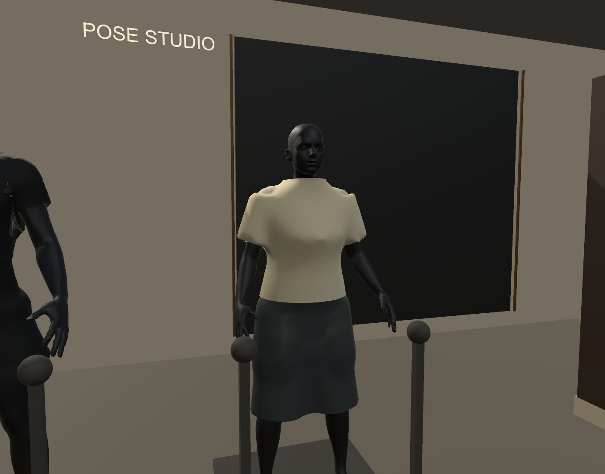
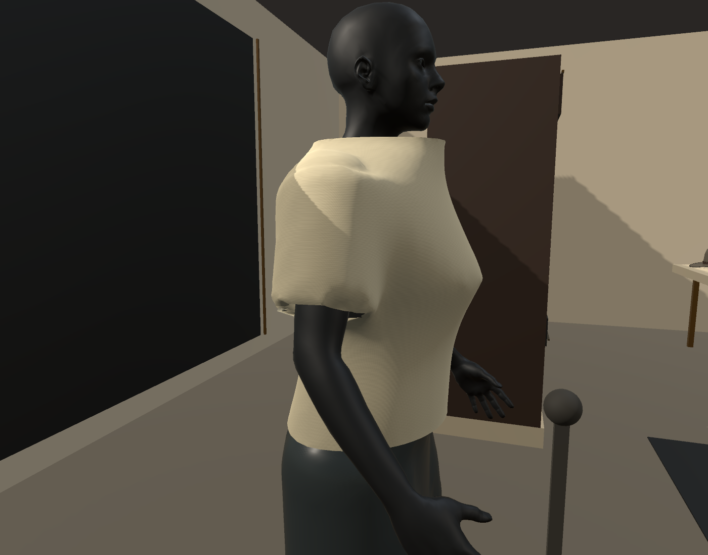
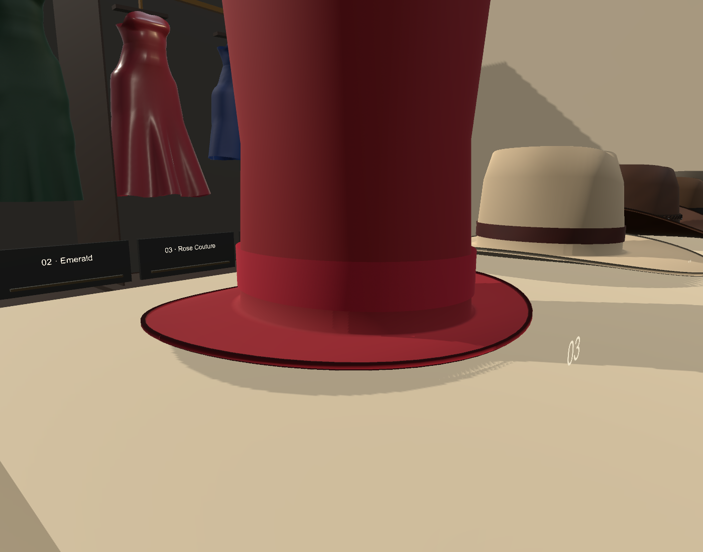
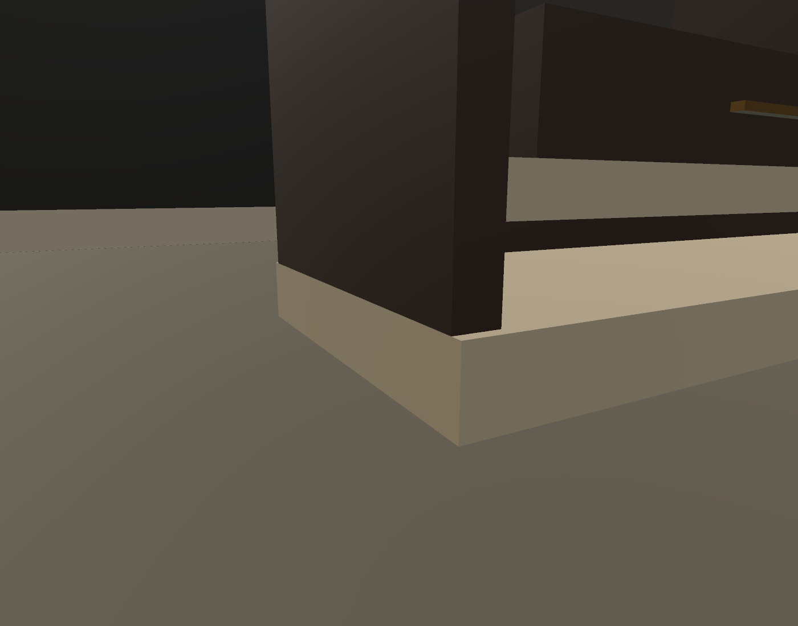
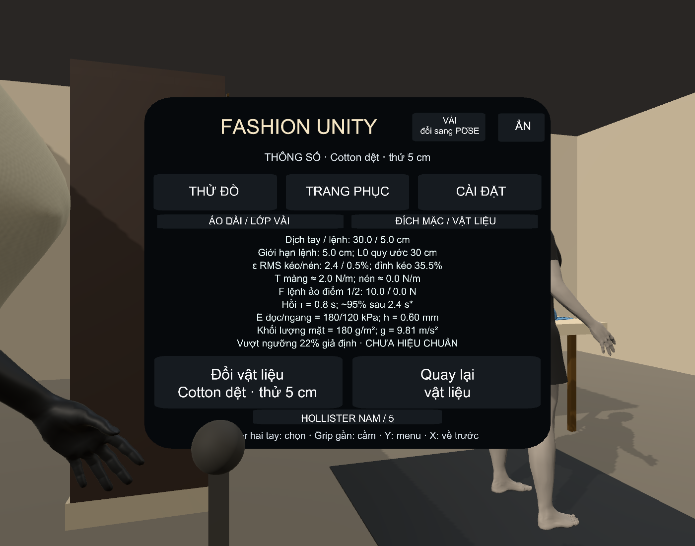
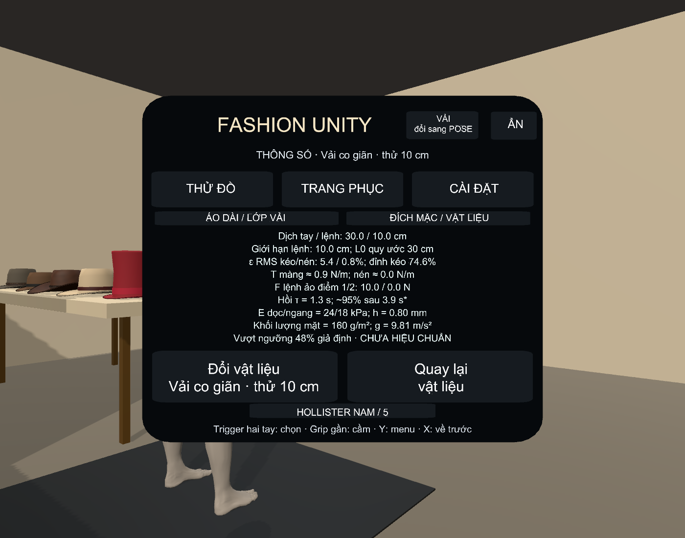

# Mép áo, nón, chân tủ và số liệu kéo giãn — V088

Ngày 02/11/2026. Source sửa trực tiếp tại `C:\Users\HUYNH\OneDrive\Desktop\FashionFitPrototype`.
Game mới: `C:\Users\HUYNH\Downloads\FashionFit_Run\Versions\V088_Surface\FashionFittingRoom.exe`.
[Hướng dẫn VR và bảng đầy đủ các tham số](../../Docs/SURFACE_READOUT_VR_GUIDE.md).
Kết quả chạy tại đường dẫn đã cài được lưu thêm trong `actual_*.json`; `deployment.json` xác nhận việc thay launcher và cài game.

## Các lỗi trong ảnh

**Áo Ivory:** cách cũ cắt tam giác từ cơ thể theo nhãn xương làm biên nách/tay/gấu không đều. Bản mới dựng bao thân–tay liên tục, giữ cửa cổ, hai cửa tay và gấu. Phần hông được tính cả các điểm có trọng số đùi ở vùng tiếp giáp, tránh eo áo quá hẹp làm cạp váy ló ra thành vệt đứt. Tạo lại Ivory nam/nữ và hai bộ nam tay ngắn; áo chính dùng cùng bộ tạo. Áo dài/tay dài vẫn giữ cấu trúc trước, chưa thay tất cả trang phục bằng lưới mới.

Bộ tạo dùng trường hình học và polygonisation tetrahedra, tham khảo nguyên lý [Paul Bourke: Polygonising a Scalar Field Using Tetrahedrons](https://paulbourke.net/geometry/polygonise/); code tự triển khai, không sao chép bảng/code nguồn. Sau cắt cửa áo có hàn đỉnh, lọc mặt trùng và làm mượt nội vùng. Mẫu được kiểm tra có **5645 đỉnh / 10848 tam giác**, **1 thành phần liên thông**, đúng **4 đường biên**: cổ, gấu, hai tay. Không che/xóa cơ thể để vượt bài kiểm tra.

**Nón:** mép gốc thân và vành trước đây không cùng tọa độ và cao độ. Nay dùng chung biên, hàn chung đỉnh, thêm mặt dưới và mép trong 3 mm. Kiểm tra top hat đỏ có **64 đỉnh nối** tham gia cả thân và vành, tránh hiệu chỉnh tiếp xúc độc lập tách hai mép. Phần trang trí/đai vẫn có geometry riêng. Chưa coi toàn bộ nón có chỉ/khóa là một vật rắn kín manifold được chứng nhận.

**Tủ:** đáy vách trái/phải/lưng bằng mặt trên bệ ở y=0,12 m. Bệ dưới y=-0,006 m chạm/nhúng nhẹ 1 mm vào mặt sàn y=-0,005 m; không để đáy vách chồng xuyên xuyên bệ như trước. Viền đá nhô ra vẫn là thiết kế, không gọi mọi đường đổi màu vật liệu là khe hở.

## Thông số rõ hơn

Thêm trang riêng trong **Y → ĐÍCH MẶC / VẬT LIỆU → Căng / nén vật liệu → Xem rõ thông số**. Bảng đứng chếch bên phải, giữ hiện khi Grip. Ẩn các nhãn gợi ý nổi ở tay tại trang này để không che số. Các nút/tiêu đề và bảng số có vùng riêng; đã kiểm tra bounds chữ trong bảng.

- Dịch tay yêu cầu / lệnh bị giới hạn (cm), tách khỏi strain của lưới.
- L0 quy ước/tham chiếu; ε RMS, cực đại cục bộ và ε nén (%).
- Lực căng màng T (N/m), tách khỏi lực lệnh của hai điểm giữ (N).
- E dọc/ngang (kPa), độ dày h (mm), khối lượng diện tích (g/m²), trọng lực (m/s²).
- Hằng số hồi τ và thời gian xấp xỉ hồi 95%=3τ; cảnh báo khi cực đại vượt miền đàn hồi giả định.
- Nút đổi vật liệu và tiêu đề theo cùng vật đang cầm, kể cả khi trước đó đã chọn chế độ đo nón nhưng chuyển sang giữ áo.

Các preset Cotton 5 cm / Stretch 10 cm / Felt 2,5 cm / Leather 2 cm và các E/h/khối lượng vẫn **chưa hiệu chuẩn**. Đường F_cmd 10 N ảo chưa đồng nhất với mô hình E·h·ε. Không đo lực tay Touch, không suy sức bền từ texture và không kết luận độ giãn thực nghiệm từ tên chất liệu. Cảnh báo ngưỡng trong ảnh là kết quả thực: một số cạnh cục bộ vượt giả định dù RMS nhỏ; T ngoại suy chỉ có nghĩa minh họa. Đây không phải mô phỏng rách/đứt/FEM đầy đủ hay chứng nhận vật liệu.

## Kiểm chứng

| Nội dung | Kết quả |
|---|---|
| Trường hợp mới Editor | 28 mục đạt; 0 exception |
| Trường hợp mới trong EXE | 28 mục đạt; 0 exception |
| Đúng 1 lưới, 4 biên thiết kế | Đạt trên mẫu kiểm tra topology; không có biên phân nhánh hoặc cạnh non-manifold |
| Cotton / Stretch, dịch điểm kéo | 5.00 / 10.00 cm trong thao tác tay yêu cầu 30 cm |
| Mở bảng khi Grip và đổi đúng chất liệu | Đạt; có trường hợp đang ở chế độ nón rồi cầm áo |
| Nón và tủ | 64 đỉnh nối thân/vành; các mặt tiếp giáp tủ/bệ/sàn đạt kiểm tra tọa độ |
| Va chạm Ivory nam/nữ | 8 trạng thái Editor + 8 EXE, 766,296 điểm mẫu, không có mẫu sâu hơn 1 mm |
| Native cũ | 61 kiểm tra và 18 trạng thái body contact đạt |
| 5 bộ nam | 55 kiểm tra; 20 trạng thái Editor + 20 EXE body contact đạt |
| Áo dài | 28 kiểm tra Editor; 7 trạng thái lớp Editor; 18 kiểm tra EXE tự cập nhật PhysX/lớp và 5 trạng thái lớp đạt |
| Pose/nón; cấu hình VR; bimanual | 29 EXE; 37 Editor; 91 Editor đạt |
| Build | 0 lỗi, 2 cảnh báo optional OpenXR |

Va chạm độc lập dùng libigl triangle distance + Embree parity trên cơ thể kín nguyên vẹn, lấy mẫu đỉnh/tâm mặt/trung điểm cạnh. Các mesh xuất có SHA256; không gọi solver để tự chấm. Tà/quần/tà ở các trường hợp áo dài còn được kiểm tra giao cạnh hữu hạn–tam giác theo hai chiều. Chưa chứng minh mọi tư thế, tự va chạm hoặc va chạm liên tục. Tính liên tục topology chỉ bảo đảm không có lỗ rách do cắt lưới trong mẫu đã xét, không tự chứng minh mặt vải không thể giao nhau khi kéo.

Input Touch được tiêm qua đúng đường chọn gần/nút menu; các test mới cập nhật solver thủ công. Bộ áo dài EXE riêng kiểm tra PhysX/cập nhật tự động. **Chưa thử bằng kính và tay cầm thật trong đợt này**, chưa chứng nhận 72/90 Hz.

Mesh dựng offline được lưu theo chữ ký cơ thể, xương và bind pose. Phép thử EXE đo nạp/clone cache khoảng **0.44 ms** trong mẫu đo; không phải thời gian toàn bộ thay trang phục hoặc FPS VR. Cache tránh dựng lại trường hình học khoảng hàng trăm ms khi mặc áo; đổi body/rig không khớp sẽ dùng đường sinh lại. Chất lượng dáng cổ/vai/nếp rủ vẫn là procedural, chưa quang thực hoặc rập may chính xác.

## Xác minh bản đã cài

Đã chạy lại chính EXE tại `FashionFit_Run/Versions/V088_Surface`: 28 mục mới đạt, 0 exception, 8 trạng thái body contact đạt kiểm tra độc lập. Hai launcher `--check` đạt. SHA256 của toàn bộ tệp game khớp bản build đã kiểm thử. Các kiểm tra hồi quy khác là của cùng build trước cài, không gọi đây là thử kính thật. Xem `actual_player.json`, `actual_contact.json`.
